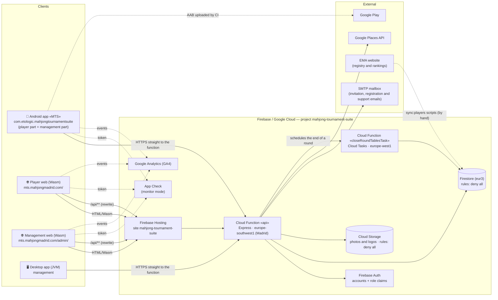

# Architecture of Mahjong Tournament Suite

An overview of the system, made to be understood at a glance. The details of each part are in the other documents of `docs/`.

| Document | What it covers |
|---|---|
| This README | The pieces of the system, the clients and where each thing runs |
| [api.md](api.md) | How the API works and where to see its Swagger documentation |
| [data.md](data.md) | What is in Firestore and in Storage, and how it relates |
| [deploy-and-versions.md](deploy-and-versions.md) | Environments, CI/CD with GitHub Actions, Google Play and versions |
| [screens.md](screens.md) | Map of the screens of the apps (wireframe), navigation and what each role sees |

**API documentation (Swagger):** https://mts.mahjongmadrid.com/api-docs/

## The idea in three sentences

- There is **one Kotlin Multiplatform codebase** (Compose) that gives the Android, web (Wasm) and desktop apps.
- There is **one backend**: an HTTP Cloud Function called `api` (Node 22 + Express, TypeScript) that does every read and write.
- **The apps never touch Firestore or Storage directly.** The rules of both deny everything; only the function (with server permissions) gets in.

## Overview diagram

## The clients

| Client | Module | Who uses it | How it reaches the API |
|---|---|---|---|
| Android app «MTS» | `androidApp` (joins `playerApp` and `adminApp`) | Players, and staff who switch to «Management» | `https://europe-southwest1-mahjong-tournament-suite.cloudfunctions.net/api` |
| Player web | `playerApp` (Wasm) | Anyone, with or without an account | `/api` of the same site (Hosting forwards it to the function) |
| Management web | `adminApp` (Wasm) at `/admin/` | Staff | `/api` of the same site |
| Desktop app | `adminApp` (JVM) | Staff | Direct URL of the function |

Shared modules: `domain` (models and rules), `data` (Ktor client of the API, DTOs, caches), `ui` and `designsystem` (Compose components). The HTTP client is `data/.../backend/FunctionsBackendApi.kt`.

The Android app takes every address of `mts.mahjongmadrid.com` (App Links) and opens it where the web does; pages that are not the app (privacy policy, Green Book, API docs) go on to the browser. See [table-qr.md](../table-qr.md).

## Roles in one line

- **Super Admin**: everything. Creates tournaments, manages accounts, the EMA registry, custom roles, errors and activity.
- **Club Admin**: manages the tournaments and the staff accounts of its organizations (clubs or federations); creates EMA players.
- **Editor**: manages the tournaments assigned to it (players, tables, hands, clock).
- **Player**: an account with an EMA number. Sees everything public and enters hands at its table while the round is open.
- **No account**: sees every public tournament (`/public/...`).
- **Custom roles**: a Super Admin creates roles that start from Editor or Club Admin with the permissions it chooses, and can add or remove single permissions for one person (`roles/{id}`, `users/{uid}.customRoles` and `.permissionChanges`).

The standard roles are Firebase Auth *custom claims*; the named permissions are in `firebase/functions/src/models/permissions.ts`. The full matrix is in [user-roles-matrix.md](../user-roles-matrix.md) and [users.md](../users.md).

## Where each thing runs («machines»)

There are no own servers: everything is *serverless* on Google Cloud.

| Piece | Where | Notes |
|---|---|---|
| Function `api` | Cloud Functions 2nd gen (Cloud Run), `europe-southwest1` (Madrid) | 512 MiB, 1 CPU, 80 requests at once per instance, max 20 instances, timeout 180 s. Madrid because the SMTP server only accepts some countries. |
| Function `closeRoundTablesTask` | `europe-west1` (Belgium) | Cloud Tasks does not exist in Madrid. It closes the tables when the time of a round ends. |
| Function `registrationsHourly` | `europe-west1` (Belgium) | Cloud Scheduler does not exist in Madrid. Every hour it calls `registrationsHourRun` (Madrid), which does the work of the registrations and sends the emails. |
| Firestore | `eur3` (Europe multi-region) | Database `(default)`. |
| Storage | default bucket of the project | `playerPhotos/`, `userPhotos/`, `tournamentLogos/`, organization logos. |
| Hosting | Firebase CDN | Serves both webs and `/api-docs/`, and forwards `/api/**` and `/version` to the function. |
| GitHub Actions | `ubuntu-latest` runners | Deploys of Firebase, Google Play uploads, staging, screenshots and game day. |
| Ernesto's Mac | local | Development, E2E tests on Android emulators (`scripts/run-e2e-parallel.py`), local test environment. |

A second Firebase project, `mts---staging`, is the staging environment (see [deploy-and-versions.md](deploy-and-versions.md)).

Secrets of the function (Secret Manager): `ID_TOOLKIT_API_KEY`, `MTS_SMTP_URI`, `PLACES_API_KEY`, `MTS_SUPPORT_EMAIL`.

## Related documents

- [backend.md](../backend.md): business rules of the backend (accounts, import, invitations…)
- [public-data.md](../public-data.md): public routes and privacy
- [web-hosting.md](../web-hosting.md): both webs on one site
- [telemetry.md](../telemetry.md): Analytics and the error log
- [activity-log.md](../activity-log.md): log of changes and activity
