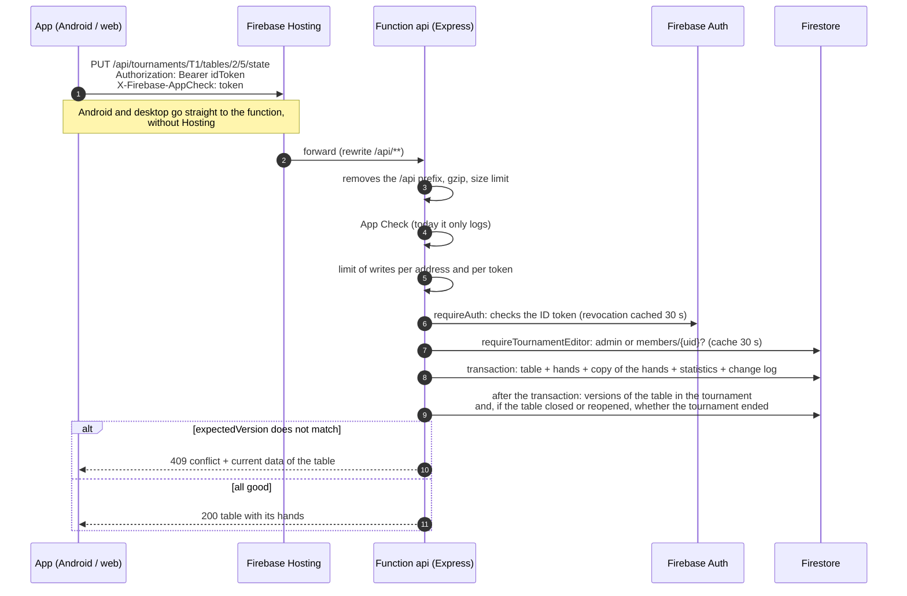

# The API

## Where to see it

**https://mts.mahjongmadrid.com/api-docs/** is a Swagger UI page with every route, grouped by topic. Each route says who can call it (🌐 public, 🔑 any account, 🀄 player of the table, ✏️ editor, 🛡️ admin), what it receives, what it returns and which errors it gives.

- It is public but not indexed (`noindex`): the code of the repository is already public, so it reveals nothing new.
- «Try it out» only works for **GET**: it is for looking at real data without risk. For routes with an account, press **Authorize** and paste an ID token.
- The file is [docs/api/openapi.json](../api/openapi.json) (OpenAPI 3.1). It also opens in Postman, Insomnia or the OpenAPI plugin of Android Studio.

## How it is kept up to date

`python3 scripts/generate-openapi.py` writes `docs/api/openapi.json`.

- **The schemas** (request and response bodies) come by themselves from the Kotlin DTOs (`data/.../backend/dto/*.kt`). They are the shapes that the apps really send and read.
- **The routes** are written by hand in the `ROUTES` list of the script. When you add a route in `firebase/functions/src/api/routes/`, add it there too. `api/clientContract.test.ts` checks that every call of the apps has a route on the server.
- After changing a DTO or a route, run the script again and commit the JSON. The deploy copies the page to the site (`scripts/assemble-web-hosting.sh`).

## How it is built

Everything is one Express application inside one Cloud Function (`firebase/functions/src/index.ts` → `api/app.ts`). The groups of routes:

| Prefix | What for | File |
|---|---|---|
| `/auth` | Sign in, refresh the token, my profile | `auth.routes.ts` |
| `/me` | My slots in the tournaments and my registrations (with a place or waiting) | `public.routes.ts` |
| `/public` | Everything anyone sees, without an account, with CDN cache | `public.routes.ts` |
| `/player` | The player enters hands, seats and penalties at its table | `player.routes.ts` |
| `/registrations` | A person registers for a tournament, with or without an account | `registrations.routes.ts` |
| `/tournaments` | Management of tournaments: players, teams, tables, clock, registrations, draw, exports, statistics | `tournaments.routes.ts` |
| `/ema-player-registry` | The shared EMA registry | `players.routes.ts` |
| `/admin` | Accounts, roles, organizations, activity, errors | `admin.routes.ts` |
| `/sync`, `/config`, `/countries`, `/venues`, `/support`, `/telemetry` | Utilities | one file each |
| `/health`, `/version` | Version of the backend | `app.ts` |

## What happens in each request



The transaction only touches documents of the table. What all the tables share (the tournament document, `_meta`) is
written right after it, and the query of open tables that decides whether the tournament ended also goes after it, in a
short transaction on the tournament. Inside the transaction of the save, that query locked the first open tables, which
in the last rounds are the ones being played, and Firestore aborted their saves (large game day, November 2026).

## Authentication

1. The app calls `POST /auth/signIn` with email and password. The backend talks to Firebase Auth and returns `idToken` (it lasts 1 hour) and `refreshToken`.
2. Every request carries `Authorization: Bearer <idToken>`.
3. If the API answers `401 unauthenticated`, the app calls `POST /auth/refresh` and tries again.

Permissions are checked by *middlewares*:

| Middleware | Lets through |
|---|---|
| `requireAuth` | Any valid token of an account that is not disabled |
| `requireEditor` | Staff claims (editor, Club Admin, Super Admin) |
| `requireTournamentEditor` | Admin, or an editor with the document `tournaments/{id}/members/{uid}` |
| `requireAdmin` | Super Admin claim |
| `requireRegisteredPlayer` | An account whose EMA number is in a slot of the tournament, and only for its table |

Named permissions (`tournament.view`, `tournament.roundControl`...) refine these checks; see [user-roles-matrix.md](../user-roles-matrix.md).

## Errors

Always the same format:

```json
{ "error": "conflict", "message": "Table data changed on the server", "details": { "code": "...", "...": "..." } }
```

| Status | `error` | When |
|---|---|---|
| 400 | `bad_request` | Data that is not valid |
| 401 | `unauthenticated` / `app_check_failed` | No token, an expired token, or App Check in enforce mode |
| 403 | `forbidden` | No permission |
| 404 | `not_found` | It does not exist (or a tournament that is not public in `/public`) |
| 409 | `conflict` | Another device saved first, an EMA number with an owner, a file with errors, a draw that is not ready (`details.code`, such as `IMPORT_PROBLEMS`) |
| 413 | `payload_too_large` | Body too large (8 MB; 256 KB on routes without an account) |
| 429 | `too_many_requests` | Request limit |
| 500 | `internal` | Server failure (it shows in the logs of the function) |

## Limits and cache

- Writes: 600/min per IP address, 120/min per token and 120/min per account.
- `/public` routes: 20,000 reads/min per address (a venue shares one address). Answers with `Cache-Control` for the CDN: 15 s while the tournament is in play, 300 s when it is finished, 60 s lists, 1 h EMA registry and countries.
- Other answers: `no-store` (they carry personal data).
- Without an account: sign-in 30/min, support 3 every 15 min, error reports 30/min.
- Registrations: 20 every 15 min per address, 5 emails an hour about one person of a tournament and 300 registration
  emails an hour per instance of the API. A pending registration that a second email asks for gets a new link.
- The address of a client comes from `clientAddress()` (`api/clientAddress.ts`), never from the first entry of
  `X-Forwarded-For`, which the client writes: on a direct call it is the last entry, which Google adds; through
  Firebase Hosting it is the entry before the Google proxy of Hosting. Each deploy of staging checks it with forged
  headers (`/debug/forwarded`, staging only).

## Light sync

The apps do not download everything every time. `GET /public/sync/manifest` and `GET /public/tournaments/{id}/sync/manifest` return a revision number per resource (players, tables, rounds…) and the version of each table. The app compares them and only asks for what changed. The revisions live in `_meta/dataVersions` and in the tournament document itself.
