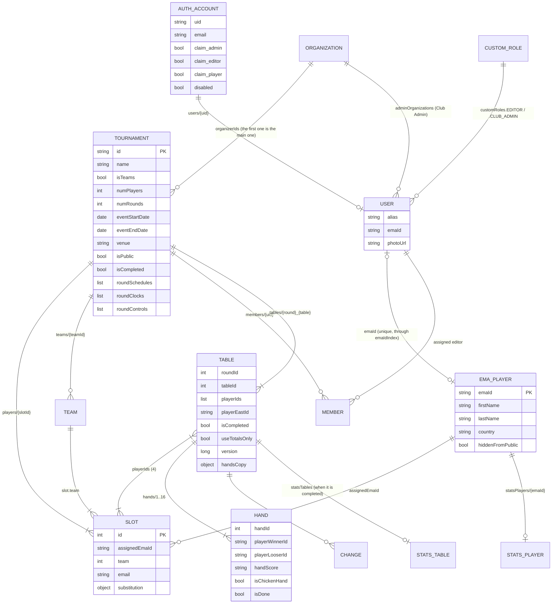

# Data: Firestore and Storage

Only the `api` function (and the maintenance scripts of `firebase/functions/src/scripts`) read and write here. The rules of Firestore and Storage deny everything to the apps.

## Map of the collections

```mermaid
flowchart TB
  subgraph root["Root collections"]
    users["users/{uid}<br/>alias, emaId, photoUrl,<br/>adminOrganizations, customRoles,<br/>permissionChanges"]
    organizations["organizations/{id}<br/>name, type (CLUB/FEDERATION),<br/>country, primaryColor, logoUrl,<br/>place (club venue, optional)"]
    roles["roles/{id}<br/>name, base, permissions<br/>(custom roles)"]
    emaIdIndex["emaIdIndex/{emaId}<br/>uid (who owns the EMA number)"]
    registry["emaPlayerRegistry/{emaId}<br/>firstName, lastName, country,<br/>photoUrl, hiddenFromPublic"]
    countries["countries/{code}<br/>code, name"]
    tournaments["tournaments/{tournamentId}<br/>organizerIds (principal primero)"]
    stats["statsTables · statsPlayers ·<br/>statsTournaments · statsGlobal"]
    activity["activity/{id}<br/>management actions"]
    errors["errorGroups/{id}<br/>└ reports/{id}"]
    meta["_meta/dataVersions<br/>global revisions"]
    personPrivate["personPrivate/{emaId}<br/>food restrictions<br/>(private, with consent)"]
    slugs["registrationSlugs/{slug}<br/>tournamentId of the short link /slug"]
    sync["emaPlayerRegistrySyncReports · …SyncState ·<br/>emaRankingTournamentResultIndex"]
  end

  subgraph tournament["Inside each tournament"]
    members["members/{uid}<br/>assigned editors"]
    players["players/{slotId}<br/>slot: assignedEmaId, team,<br/>pending email, substitution"]
    teams["teams/{teamId}<br/>name"]
    rounds["rounds/{roundId}"]
    tables["tables/{roundId}_{tableId}<br/>playerIds, seats, points,<br/>isCompleted, version, handsCopy"]
    hands["hands/{1..16}<br/>winner, loser, points,<br/>isChickenHand, penalties"]
    changes["changes/{id}<br/>log of each save of a table"]
    playerLog["playerLog/{id}<br/>changes of person in a slot"]
    assignments["emaPlayerAssignments/{emaId}<br/>EMA number → slot"]
    registrations["registrations/{emaId or row-N}<br/>registration before the draw:<br/>status, position, email, team, paid,<br/>problems and fileEmaId of an import"]
    regTeams["registrationTeams/{id}<br/>name, captain"]
    regLog["registrationLog/{id}<br/>changes for the weekly report"]
  end

  tournaments --> members & players & teams & rounds & tables & changes & playerLog & assignments & registrations & regTeams & regLog
  registrations -. emaId .-> personPrivate
  slugs -. tournamentId .-> tournaments
  tables --> hands
  users -. emaId .-> registry
  emaIdIndex -. uid .-> users
  players -. assignedEmaId .-> registry
  members -. uid .-> users
  tournaments -. organizerIds .-> organizations
  users -. adminOrganizations .-> organizations
  users -. customRoles .-> roles
```

## Relations (entity-relationship model)

## The important things in a few lines

- **Account ≠ EMA player.** A Firebase Auth account (`users/{uid}`) can have an EMA number. The EMA player lives in `emaPlayerRegistry/{emaId}`, shared by every tournament. `emaIdIndex/{emaId}` makes sure that an EMA number has one account at most.
- **The standard roles are not in Firestore**: they are *custom claims* of the account in Firebase Auth (`superAdmin`, `clubAdmin`, `editor`, `player`).
- **Organizations (clubs and federations) own the tournaments.** A tournament has one or more organizers (`organizerIds`); the first one is the main one and the tournament uses its logo and its color. The Club Admins of each organizer manage the tournament.
- **Custom roles and the permissions of one person** (see [user-roles-matrix.md](../user-roles-matrix.md)): `roles/{id}` keeps a role that a Super Admin creates, with `base` EDITOR or CLUB_ADMIN (which gives its scope and the most it can have) and its list of `permissions`. `users/{uid}.customRoles.{EDITOR|CLUB_ADMIN}` says which custom role the account uses at that level, and `users/{uid}.permissionChanges.{level}` keeps only the difference with the role (`added`, `removed`). The backend computes what it can do: role + added − removed, cut to what the base allows and always with `tournament.view`. Deleting a role deletes `customRoles.{base}` from its accounts.
- **A tournament has slots** numbered from 1 to N (`players/{slotId}`). Each slot has an EMA number or is empty. An account «plays» a tournament when its EMA number is in a slot: no account↔tournament link is stored, it is computed.
- **Registrations before the draw** live in `registrations/{emaId}`. A row of an import without a valid EMA number gets the id `row-<line>`, keeps the text of the file in `fileEmaId` and its `problems`; the draw refuses while a person with a place has an EMA problem (docs/registrations.md).
- **The app makes the rounds and the tables** (the draw) when the tournament is created or the registrations close; the backend only checks and saves them.
- **Each table has 16 hands** (`hands/1..16`) and a copy of the 16 in the table document itself (`handsCopy`), to read a table with one read.
- **The `version` of a table** goes up with each save. Who saves sends the version it had (`expectedVersion`); if it does not match, 409. So two devices never overwrite each other.
- **The statistics are computed when saving**, in the same transaction: `statsTables` (summary of a completed table), `statsPlayers` (sums per person), `statsTournaments` (standings), `statsGlobal/overview-{n}` (totals split into pieces).
- **Audit:** `tournaments/{id}/changes` keeps each save, reset or conflict of a table with who changed what; `activity` keeps the other management actions. See [activity-log.md](../activity-log.md).
- **App errors:** `errorGroups/{id}` groups equal errors; `reports` keeps the latest reports. See [telemetry.md](../telemetry.md).

## Storage

| Folder | Content | Who writes it |
|---|---|---|
| `playerPhotos/{emaId}.jpg` | Photo of the EMA player (public since November 2026: rankings and player header) | Admin, or the sync script with the EMA |
| `userPhotos/{uid}.{ext}` | Own photo of an account | The user (`PUT /auth/me/photo`) or an admin |
| `tournamentLogos/{tournamentId}.{ext}` | Logo of the association (ID cards) | Admin, when creating or editing the tournament |

The public URLs carry a download token. Which photos the `/public` routes give is in [public-data.md](../public-data.md).

## Indexes

`firebase/firestore.indexes.json`: collection group indexes (`members.uid`, `players.assignedEmaId`) and the composite ones of the activity log. The emulator does not need them, so a query without its index only fails in production.
