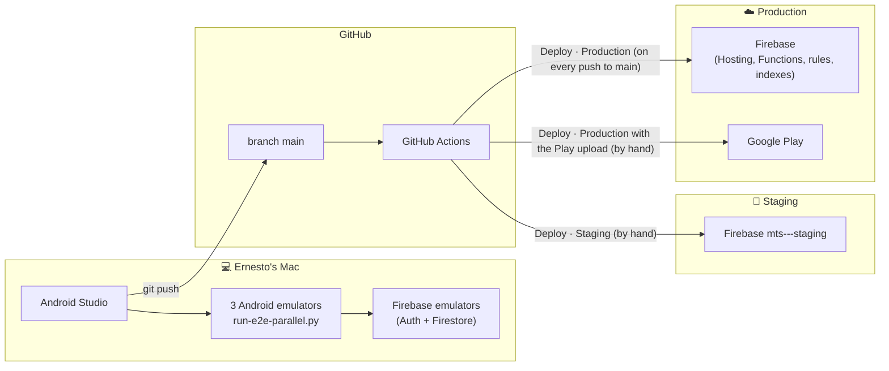
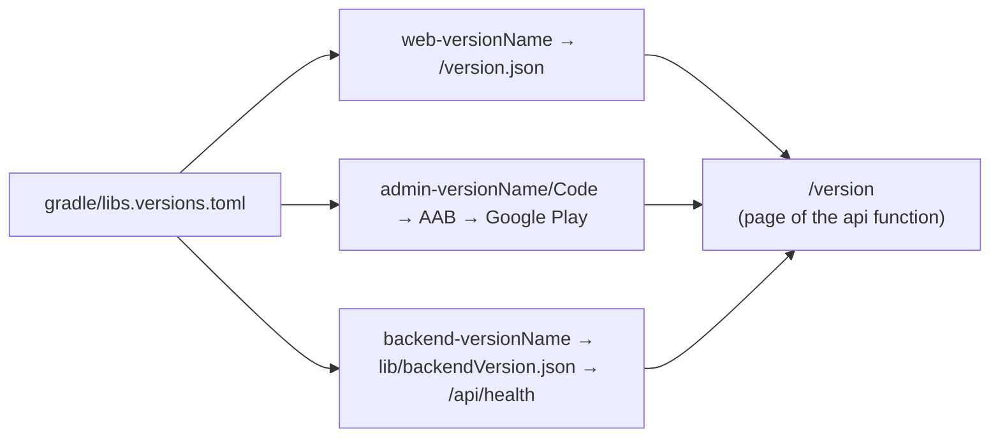

# Environments, deploys and versions

## Environments

| Environment | Backend | Data | What for |
|---|---|---|---|
| **Production** | Firebase project `mahjong-tournament-suite` | Real | The published apps |
| **Staging** | Firebase project `mts---staging` (web https://mts---staging.web.app, Android app «MTS Staging») | Test data only | Rehearse a whole tournament before a release, with real devices, emulators and bots. See [staging.md](../staging.md) |
| **Local tests** | The real API on the Auth and Firestore emulators (`npm run test-env:backend`), at `http://localhost:5055/api` | Fake, made again on every start | Try the webs without touching production. See [test-environment.md](../test-environment.md) |
| **E2E tests** | The same local backend (`npm run e2e:backend`); the Android emulator reaches the Mac through `10.0.2.2` | Fake | Instrumented tests on Android emulators (Mac or GitHub Actions) |
| **Integration tests** | Emulators, project `demo-mts-tests` | Fake | `npm run test:integration` |

## GitHub Actions

The workflows are named by kind: Test, Deploy, Check and Publish.

| Workflow | When | What it does |
|---|---|---|
| `firebase.yml` «Deploy · Production» | Push to `main` (and by hand) | `firebase deploy` (without tests until production) of hosting (both webs + `/api-docs/`), functions, rules and indexes. The upload to Google Play only when it is started by hand on main. Started by hand on another branch, it runs every unit and integration test and deploys nothing. |
| `staging.yml` «Deploy · Staging» | By hand | Deploys main on staging (`deploy`) or seeds it (`seed`). |
| `ui-tests.yml` «Test · UI (emulators)» | By hand | Instrumented tests on a GitHub emulator or Firebase Test Lab |
| `screenshots.yml` «Test · Screenshots» | By hand | Screenshot tests (Roborazzi): verify or record |
| `scenario.yml` «Test · Game day · Auto» | By hand | Bots play a whole tournament against staging (small, medium, large or the quick «corners») |
| `rehearsal.yml` «Test · Game day · Participating» | By hand | The same with real people taking part |
| `screenshot-gallery.yml` «Publish · Screenshot gallery» | Push to `main` that changes screenshots (and by hand) | Publishes https://mts-staging-screenshots.web.app with the history of the screenshots |
| `versions.yml` «Check · Published versions» | By hand | Shows the version of `main` next to the published one |
| `benchmark.yml` «Check · Production benchmark» | By hand (the automatic triggers are paused) | Response times of the public API and load of the web in production. It only reads. |

The deploy signs in to Google Cloud with Workload Identity Federation (service account `github-deployer`), with no stored keys. Details in [ci-deploy.md](../ci-deploy.md) and [android-release.md](../android-release.md).

Current way of working: each task on its own branch, and when it is done it is merged and pushed straight to `main` (no pull request), which deploys.

## Versions

Three products, each one with its version in `gradle/libs.versions.toml`:

| Product | Key | Where to see the published one |
|---|---|---|
| Web (both webs) | `web-versionName` | `https://mts.mahjongmadrid.com/version.json` |
| Android app (and desktop) | `admin-versionName` / `admin-versionCode` | Google Play |
| Backend (`firebase/`) | `backend-versionName` | `GET /api/health` |

- **https://mts.mahjongmadrid.com/version** shows a table of the three: the latest version (of `main`) next to the published one, with ✓ when they match.
- From a terminal: `python3 scripts/versions.py status`.
- They go up with `scripts/versions.py`. See [versioning.md](../versioning.md).

