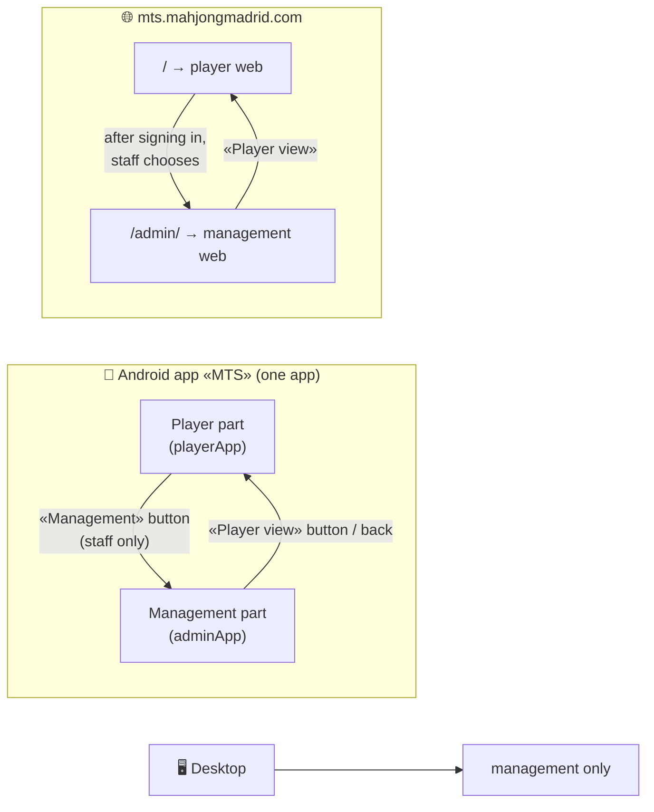
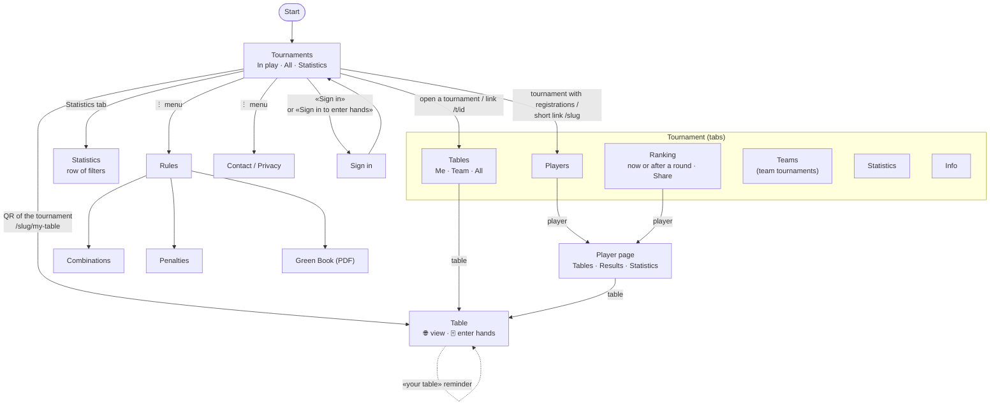
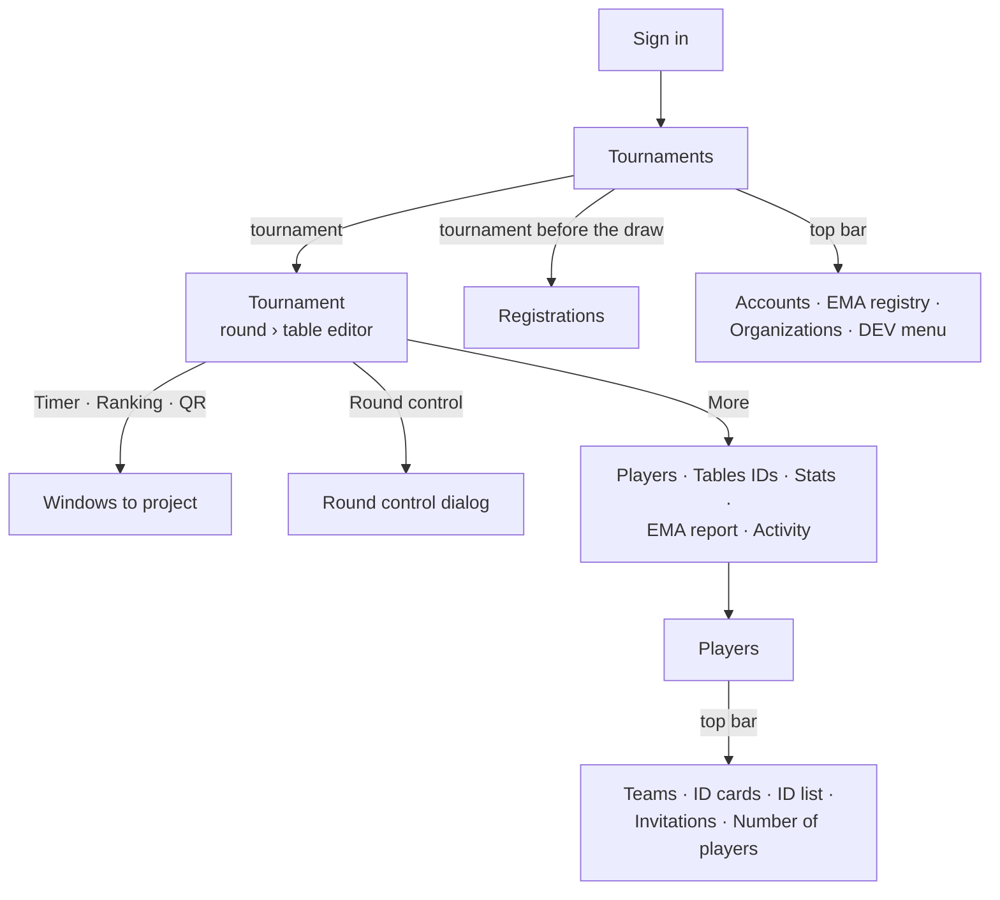

# Map of the screens (wireframe)

How to move around the apps and what each role sees. The pictures are the ones of the screenshot tests (`*/screenshots/*/phone-light.png`, sample data), so they update themselves when they are recorded again. There are desktop, tablet, dark and other language versions in the same folders. The full list of features is in [features.md](../features.md).

## How the apps fit together

## Player app

It always starts at the list of tournaments. No account is needed to see anything; an account only marks «me» and lets you enter hands at your own table.

| Screen | Who | What it does | Picture |
|---|---|---|---|
| **Tournaments (no account)** | Everyone | Tabs In play · All · Statistics, with filters (status, country, year). Sign-in button. |  |
| **Tournaments (with an account)** | Player | The same, with the tournaments where you play at the top and the marks Playing / Played / Registered / Waiting list. |  |
| **Tournament › Tables** | Everyone | Me / Team / All. Tables per round with live results. |  |
| **Tournament › Ranking** | Everyone | Players, teams, chicken hands and best hand. A round button shows the ranking after a past round, and Share makes an image. |  |
| **Tournament › Players** | Everyone | Search; opens the player page. |  |
| **Tournament › Players (registrations)** | Everyone sees · anyone registers | Before the draw there are only Players and Info. Places, waiting list, Register, My registration (food, team, cancel) and «I have no EMA number». Short link `/<slug>`, for example `/6thmmc` (docs/registrations.md). |  |
| **Tournament › Teams** | Everyone | Team tournaments only. |  |
| **Tournament › Statistics** | Everyone | Totals and hands, per round. |  |
| **Tournament › Info** | Everyone | Progress, round times, venue, agenda, contact and organizers. |  |
| **Player page › Tables** | Everyone | The tables of the player in the tournament. |  |
| **Player page › Results** | Everyone | Every round in one table, with a chart of the place after each round, shareable as an image. |  |
| **Player page › Statistics** | Everyone | Standing (with the chart of the place per round), skills and totals. |  |
| **Table (in play)** | Everyone sees · the players of the table enter | Seats, points and hands. The players of the table enter hands, seats and penalties while the round is open. |  |
| **Table (completed)** | Everyone | Final result and every hand. |  |
| **Statistics** | Everyone | One screen with a row of filters: player, rival, tournament, countries and years. |  |
| **Combinations** | Everyone | The 81 MCR combinations with tile examples. |  |
| **Penalties** | Everyone | Table of penalties. |  |

## Management app

| Screen | Who | What it does | Picture |
|---|---|---|---|
| **Sign in** | Staff (Super Admin, Club Admin, editor) | On the web, a staff account chooses «Player view» or «Management». |  |
| **Tournaments** | Super Admin: all · Club Admin: those of its organizations · Editor: assigned | Create (Super Admin and Club Admin), edit, open. Top bar: accounts, EMA registry, organizations, clock; DEV menu (Super Admin). |  |
| **Tournament (round editor)** | Staff of the tournament | Round › table: players, seats, points and the 16 hands. Top bar: Timer, Ranking, QR and Round control; Players, Tables IDs, Stats, EMA report and Activity in the More menu. |  |
| **Registrations** | Staff of the tournament | Before the draw: public link, places, waiting list, paid, food, the import of the Google Form (it replaces the list and marks the rows with problems), settings and Make the draw. |  |
| **Tournament players** | Staff of the tournament | Slots, EMA numbers, import and export, substitutions, the tables per round of each player (folded). Top bar: Teams, ID cards, ID list, Invitations and Number of players. |  |
| **Number of players** | Who configures the tournament | Before the first hand: mark the people who leave or add tables, complete the teams, review and a new draw; those who stay keep their number (docs/player-count-change.md). |  |
| **QR and Tables IDs** | Admin or editor of the tournament | "QR" button of the top bar: a separate window with the QR of the tournament to project, with the organizer's logo or initial (it opens My tables in the Player, with the table in play or the next one). More › "Tables IDs": a dialog with a PDF of one card per table (big number + QR), 1, 2, 4, 6 or 8 per A4, with a preview (docs/table-qr.md). |  |
| **Teams** | Staff of the tournament | Name and members of each team. Opens from Players. |  |
| **Ranking (big screen)** | Staff of the tournament | To project in the venue; it pages by itself. |  |
| **Round clock** | Staff of the tournament | Starts, pauses and sets the time of the round; opens the hands to the players. |  |
| **Statistics** | Staff | The same screen as the Player, with the same filters. |  |
| **Accounts** | Staff: every player and the staff of its organizations · Super Admin: all | Create, edit, deactivate and delete (Super Admin), password email. The **Permissions** button of a staff account: custom role (also the Club Admin, in its organizations) and single boxes (Super Admin). |  |
| **Roles** | Super Admin | Standard roles (read only, can be duplicated) and custom roles that start from Editor or Club Admin: name, permission boxes, how many accounts use it. Opens from Accounts. |  |
| **Organizations** | Super Admin and Club Admin | Clubs and federations in a grid of cards, with logo, color and an optional club venue. |  |
| **EMA registry** | Super Admin edits · Club Admin creates · Editor looks | EMA players, photos, hide from the public, delete EMA players. |  |
| **Activity** | Super Admin (the whole app) · Club Admin (its tournaments) | Who changed what and when, with filters. |  |
| **App errors** | Super Admin | Errors of every app, grouped. |  |
| **Design system** | Super Admin | Catalogue of colors and components (DEV menu). |  |

The dialogs (create or edit a tournament, invitations, import of players, round control, profile…) have their pictures in `adminApp/screenshots/dialogs/` and `playerApp/screenshots/dialogs/`.

## Which role sees what (summary)

| | No account | Player | Editor | Club Admin | Super Admin |
|---|:-:|:-:|:-:|:-:|:-:|
| See public tournaments, tables, rankings, statistics | ✅ | ✅ | ✅ | ✅ | ✅ |
| Mark «me», «my tournaments» | | ✅ | ✅* | ✅* | ✅* |
| Enter hands and seats at your table (open round) | | ✅ | ✅* | ✅* | ✅* |
| Manage tournaments (players, tables, hands, clock, round control, exports) | | | Assigned | Its organizations | All |
| Create, delete and configure tournaments, reset a table, activity of the tournament | | | | Its organizations | All |
| Accounts: create players | | | ✅ | ✅ | ✅ |
| Accounts: editors and Club Admins | | | | Its organizations | ✅ |
| Deactivate or delete accounts, the email or EMA number of an account | | | | | ✅ |
| EMA registry: create / edit and delete | | | | Create | ✅ |
| DEV menu: activity of the app, errors, design system | | | | | ✅ |

\* when the account also has an EMA number. Custom roles change these boxes one by one. The detailed matrix is in [user-roles-matrix.md](../user-roles-matrix.md).
