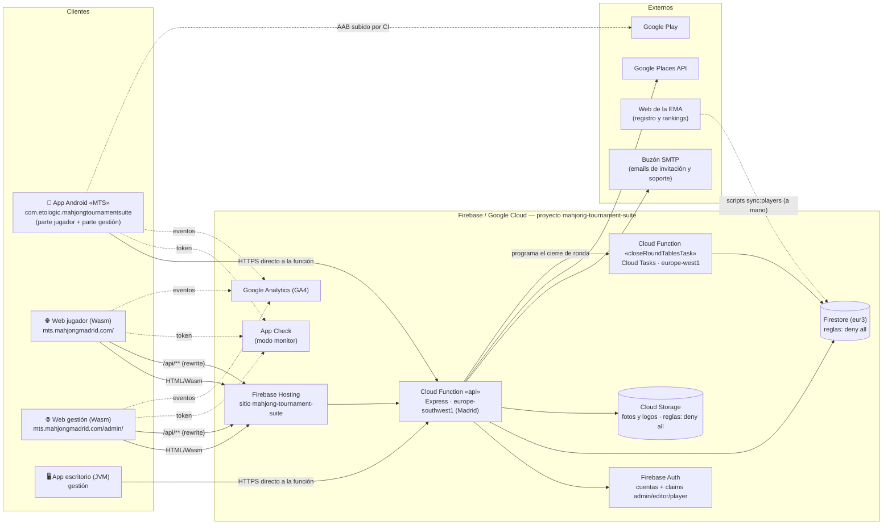

# Arquitectura de Mahjong Tournament Suite

Una vista general del sistema, pensada para entenderlo de un vistazo. Los detalles de cada parte están en los demás documentos de `docs/`.

| Documento | Qué cuenta |
|---|---|
| Este README | Las piezas del sistema, los clientes y dónde corre cada cosa |
| [api.md](api.md) | Cómo funciona la API y dónde ver su documentación tipo Swagger |
| [datos.md](datos.md) | Qué hay en Firestore y en Storage, y cómo se relaciona |
| [despliegue-y-versiones.md](despliegue-y-versiones.md) | Entornos, CI/CD con GitHub Actions, Google Play y versiones |
| [pantallas.md](pantallas.md) | Mapa de pantallas de las apps (wireframe), navegación y qué ve cada rol |

**Documentación de la API (Swagger):** https://mts.mahjongmadrid.com/api-docs/

## La idea en tres frases

- Hay **un solo código Kotlin Multiplatform** (Compose) que da las apps de Android, web (Wasm) y escritorio.
- Hay **un solo backend**: una Cloud Function HTTP llamada `api` (Node 22 + Express, TypeScript) que hace todas las lecturas y escrituras.
- **Las apps nunca tocan Firestore ni Storage directamente.** Las reglas de los dos lo niegan todo; solo la función (con permisos de servidor) entra.

## Diagrama general

## Los clientes

| Cliente | Módulo | Quién lo usa | Cómo llega a la API |
|---|---|---|---|
| App Android «MTS» | `androidApp` (junta `playerApp` y `adminApp`) | Jugadores, y admins/editores que cambian a «Gestión» | `https://europe-southwest1-mahjong-tournament-suite.cloudfunctions.net/api` |
| Web jugador | `playerApp` (Wasm) | Cualquiera, con o sin cuenta | `/api` del mismo sitio (Hosting reenvía a la función) |
| Web gestión | `adminApp` (Wasm) en `/admin/` | Admins y editores | `/api` del mismo sitio |
| App escritorio | `adminApp` (JVM) | Admins/editores | URL directa de la función |

Módulos compartidos: `domain` (modelos y reglas), `data` (cliente Ktor de la API, DTOs, cachés), `ui` y `designsystem` (componentes Compose). El cliente HTTP es `data/.../backend/FunctionsBackendApi.kt`.

## Roles en una línea

- **Admin**: todo. Crea torneos, gestiona cuentas, registro EMA, errores y actividad.
- **Editor**: gestiona los torneos que tiene asignados (jugadores, mesas, manos, reloj).
- **Jugador**: cuenta con un EMA id. Ve todo lo público y apunta manos en su mesa cuando la ronda está abierta.
- **Sin cuenta**: ve todos los torneos públicos (`/public/...`).

Los roles son *custom claims* de Firebase Auth. La matriz completa está en [user-roles-matrix.md](../user-roles-matrix.md) y [users.md](../users.md).

## Dónde corre cada cosa («máquinas»)

No hay servidores propios: todo es *serverless* en Google Cloud.

| Pieza | Dónde | Notas |
|---|---|---|
| Función `api` | Cloud Functions 2ª gen (Cloud Run), `europe-southwest1` (Madrid) | 512 MiB, máx. 20 instancias, timeout 180 s. Madrid porque el SMTP solo acepta algunos países. |
| Función `closeRoundTablesTask` | `europe-west1` (Bélgica) | Cloud Tasks no existe en Madrid. Cierra las mesas cuando acaba el tiempo de una ronda. |
| Firestore | `eur3` (multirregión Europa) | Base `(default)`. |
| Storage | bucket por defecto del proyecto | `playerPhotos/`, `userPhotos/`, `tournamentLogos/`. |
| Hosting | CDN de Firebase | Sirve las dos webs, `/api-docs/` y reenvía `/api/**` y `/version` a la función. |
| GitHub Actions | runners `ubuntu-latest` | Tests, deploy de Firebase y subida a Google Play. |
| Mac de Ernesto | local | Desarrollo, tests E2E en emuladores Android (`scripts/run-e2e-parallel.py`), entorno de pruebas local. |

Secretos de la función (Secret Manager): `ID_TOOLKIT_API_KEY`, `MTS_SMTP_URI`, `PLACES_API_KEY`, `MTS_SUPPORT_EMAIL`.

## Documentos relacionados

- [backend.md](../backend.md): reglas de negocio del backend (cuentas, importación, invitaciones…)
- [public-data.md](../public-data.md): rutas públicas y privacidad
- [web-hosting.md](../web-hosting.md): las dos webs en un solo sitio
- [telemetry.md](../telemetry.md): Analytics y registro de errores
- [activity-log.md](../activity-log.md): registro de cambios y actividad
