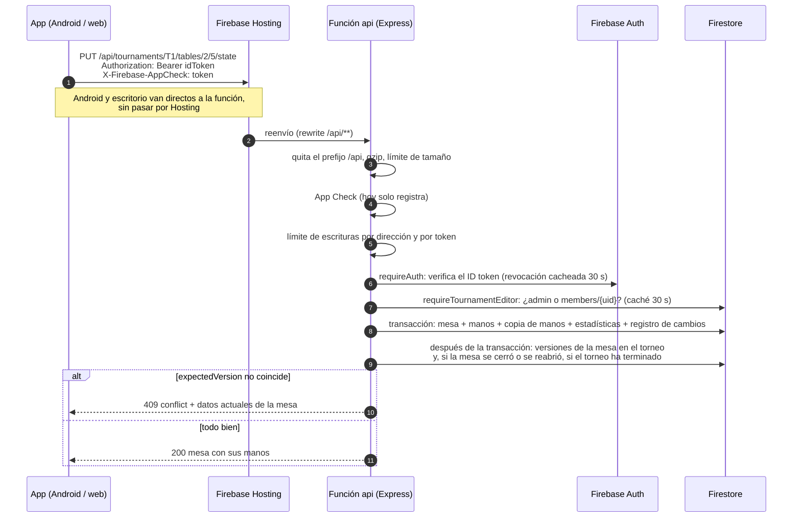

# La API

## Dónde verla

**https://mts.mahjongmadrid.com/api-docs/** es una página Swagger UI con las 100 rutas, agrupadas por tema. Cada ruta dice quién puede llamarla (🌐 público, 🔑 cualquier cuenta, 🀄 jugador de la mesa, ✏️ editor, 🛡️ admin), qué recibe, qué devuelve y qué errores da.

- Es pública pero no indexada (`noindex`): el código del repositorio ya es público, así que no revela nada nuevo.
- «Try it out» solo está activo para **GET**: sirve para mirar datos reales sin riesgo. Para rutas con cuenta, pulsa **Authorize** y pega un ID token.
- El fichero es [docs/api/openapi.json](../api/openapi.json) (OpenAPI 3.1). También se puede abrir en Postman, Insomnia o en el plugin OpenAPI de Android Studio.

## Cómo se mantiene

`python3 scripts/generate-openapi.py` escribe `docs/api/openapi.json`.

- **Los esquemas** (cuerpos de petición y respuesta) salen solos de los DTO de Kotlin (`data/.../backend/dto/*.kt`). Son las formas que las apps envían y leen de verdad.
- **Las rutas** están escritas a mano en la lista `ROUTES` del script. Al añadir una ruta en `firebase/functions/src/api/routes/`, añádela también ahí.
- Tras cambiar un DTO o una ruta, vuelve a ejecutar el script y sube el JSON. El deploy copia la página al sitio (`scripts/assemble-web-hosting.sh`).

## Cómo está montada

Todo es una aplicación Express dentro de una sola Cloud Function (`firebase/functions/src/index.ts` → `api/app.ts`). Los grupos de rutas:

| Prefijo | Para qué | Fichero |
|---|---|---|
| `/auth` | Iniciar sesión, renovar token, mi perfil | `auth.routes.ts` |
| `/me` | Mis huecos en los torneos | `public.routes.ts` |
| `/public` | Todo lo que ve cualquiera, sin cuenta, con caché CDN | `public.routes.ts` |
| `/player` | El jugador apunta manos, asientos y penalizaciones en su mesa | `player.routes.ts` |
| `/tournaments` | Gestión de torneos: jugadores, equipos, mesas, reloj, exportaciones, estadísticas | `tournaments.routes.ts` |
| `/ema-player-registry` | Registro EMA compartido | `players.routes.ts` |
| `/admin` | Cuentas, actividad, errores | `admin.routes.ts` |
| `/sync`, `/config`, `/countries`, `/venues`, `/support`, `/telemetry` | Utilidades | un fichero cada uno |
| `/health`, `/version` | Versión del backend | `app.ts` |

## Qué pasa en cada petición



La transacción solo toca documentos de la mesa. Lo que comparten todas las mesas (el documento del torneo, `_meta`)
se escribe justo después, y la consulta de mesas abiertas que decide si el torneo ha terminado también va después, en
una transacción corta sobre el torneo. Dentro de la transacción del guardado, esa consulta bloqueaba las primeras mesas
abiertas, que en las últimas rondas son las que se están jugando, y Firestore abortaba sus guardados (Game day grande,
noviembre de 2026).

## Autenticación

1. La app llama a `POST /auth/signIn` con email y contraseña. El backend habla con Firebase Auth y devuelve `idToken` (dura 1 hora) y `refreshToken`.
2. Cada petición lleva `Authorization: Bearer <idToken>`.
3. Si la API responde `401 unauthenticated`, la app llama a `POST /auth/refresh` y repite.

Los permisos se comprueban con *middlewares*:

| Middleware | Deja pasar a |
|---|---|
| `requireAuth` | Cualquier token válido de una cuenta no desactivada |
| `requireEditor` | Claims `editor` o `admin` |
| `requireTournamentEditor` | Admin, o editor con documento `tournaments/{id}/members/{uid}` |
| `requireAdmin` | Claim `admin` |
| `requireRegisteredPlayer` | Cuenta cuyo EMA id está en un hueco del torneo, y solo para su mesa |

## Errores

Siempre el mismo formato:

```json
{ "error": "conflict", "message": "Table data changed on the server", "details": { "...": "..." } }
```

| Código | `error` | Cuándo |
|---|---|---|
| 400 | `bad_request` | Datos que no valen |
| 401 | `unauthenticated` / `app_check_failed` | Sin token, token caducado, o App Check en modo enforce |
| 403 | `forbidden` | Sin permiso |
| 404 | `not_found` | No existe (o torneo no público en `/public`) |
| 409 | `conflict` | Otro dispositivo guardó antes, EMA id con dueño, fichero con errores |
| 413 | `payload_too_large` | Cuerpo demasiado grande (8 MB; 256 KB en rutas sin cuenta) |
| 429 | `too_many_requests` | Límite de peticiones |
| 500 | `internal` | Fallo del servidor (sale en los logs de la función) |

## Límites y caché

- Escrituras: 600/min por dirección IP, 120/min por token y 120/min por cuenta.
- Rutas `/public`: 600 lecturas/min por dirección. Respuestas con `Cache-Control` para la CDN: 15 s si el torneo está en juego, 300 s si terminó, 60 s listas, 1 h registro EMA y países.
- Resto de respuestas: `no-store` (llevan datos personales).
- Sin cuenta: login 30/min, soporte 3 cada 15 min, informes de error 30/min.

## Sincronización ligera

Las apps no descargan todo cada vez. `GET /public/sync/manifest` y `GET /public/tournaments/{id}/sync/manifest` devuelven un número de revisión por recurso (jugadores, mesas, rondas…) y la versión de cada mesa. La app compara y solo pide lo que cambió. Las revisiones viven en `_meta/dataVersions` y en el propio documento del torneo.
