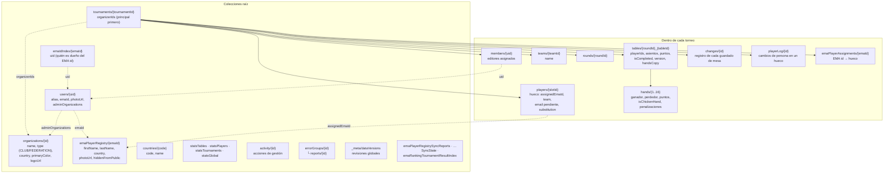
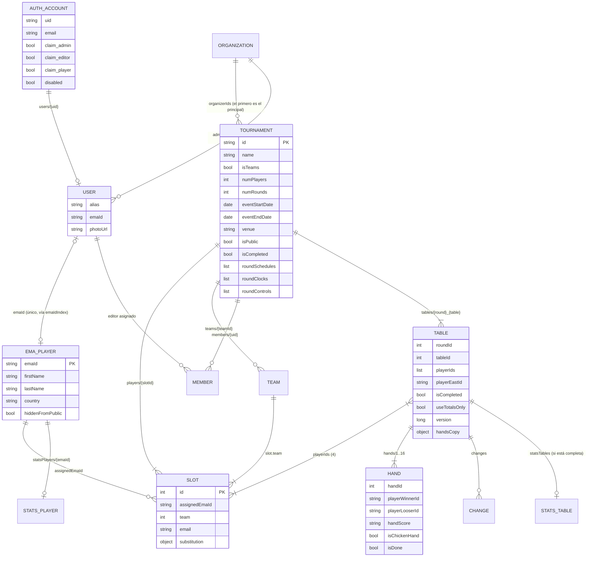

# Datos: Firestore y Storage

Solo la función `api` (y los scripts de mantenimiento de `firebase/functions/src/scripts`) leen y escriben aquí. Las reglas de Firestore y Storage niegan todo a las apps.

## Mapa de colecciones

## Relaciones (modelo entidad-relación)

## Lo importante en pocas líneas

- **Cuenta ≠ jugador EMA.** Una cuenta de Firebase Auth (`users/{uid}`) puede tener un EMA id. El jugador EMA vive en `emaPlayerRegistry/{emaId}`, compartido por todos los torneos. `emaIdIndex/{emaId}` garantiza que un EMA id tiene como mucho una cuenta.
- **Los roles no están en Firestore**: son *custom claims* de la cuenta en Firebase Auth (`superAdmin`, `clubAdmin`, `editor`, `player`).
- **Las organizaciones (clubs y federaciones) son las dueñas de los torneos.** Un torneo tiene uno o varios organizadores (`organizerIds`); el primero es el principal y el torneo usa su logo y su color. Los Club Admin de cada organizador gestionan el torneo.
- **Un torneo tiene huecos (slots)** numerados del 1 al N (`players/{slotId}`). Cada hueco tiene un EMA id o está vacío. Una cuenta «juega» un torneo si su EMA id está en algún hueco: no se guarda ningún enlace cuenta↔torneo, se calcula.
- **Rondas y mesas las genera la app** (sorteo) al crear el torneo; el backend solo valida y guarda.
- **Cada mesa tiene 16 manos** (`hands/1..16`) y una copia de las 16 en el propio documento (`handsCopy`) para leer una mesa con una sola lectura.
- **`version` de la mesa** sube con cada guardado. Quien guarda envía la versión que tenía (`expectedVersion`); si no coincide, 409. Así dos dispositivos no se pisan.
- **Las estadísticas se calculan al guardar**, en la misma transacción: `statsTables` (resumen de una mesa completa), `statsPlayers` (sumas por persona), `statsTournaments` (clasificaciones), `statsGlobal/overview-{n}` (totales repartidos en trozos).
- **Auditoría:** `tournaments/{id}/changes` guarda cada guardado/reset/conflicto de mesa con quién y qué cambió; `activity` guarda el resto de acciones de gestión. Ver [activity-log.md](../activity-log.md).
- **Errores de las apps:** `errorGroups/{id}` agrupa errores iguales; `reports` guarda los últimos informes. Ver [telemetry.md](../telemetry.md).

## Storage

| Carpeta | Contenido | Quién la escribe |
|---|---|---|
| `playerPhotos/{emaId}.jpg` | Foto del jugador EMA | Admin, o el script de sincronización con la EMA |
| `userPhotos/{uid}.{ext}` | Foto propia de una cuenta | El usuario (`PUT /auth/me/photo`) o un admin |
| `tournamentLogos/{tournamentId}.{ext}` | Logo de la asociación (acreditaciones) | Admin, al crear o editar el torneo |

Las URLs públicas llevan un token de descarga; las fotos nunca salen en las rutas `/public`.

## Índices

`firebase/firestore.indexes.json`: índices de grupo de colecciones (`members.uid`, `players.assignedEmaId`) y los compuestos del registro de actividad. El emulador no los necesita, así que una consulta sin índice solo falla en producción.
