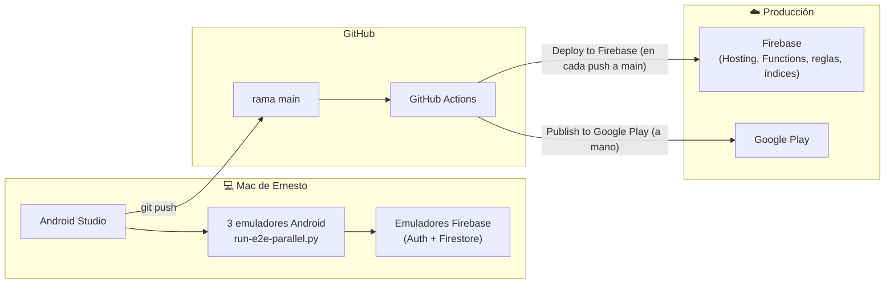
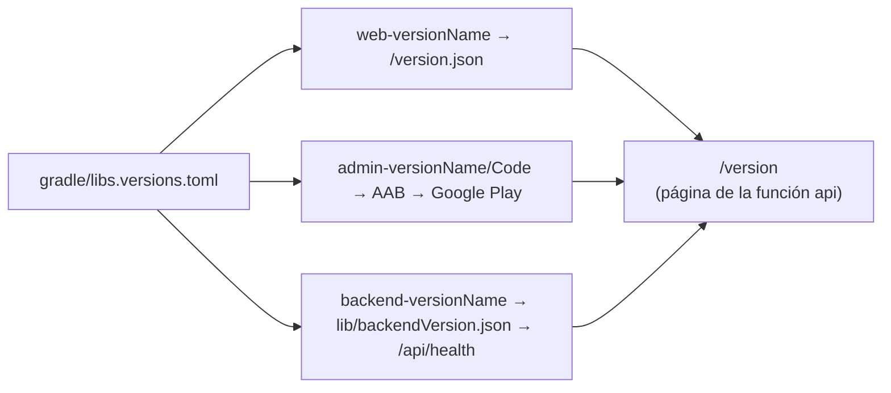

# Entornos, despliegue y versiones

## Entornos

| Entorno | Backend | Datos | Para qué |
|---|---|---|---|
| **Producción** | Proyecto Firebase `mahjong-tournament-suite` | Reales | Las apps publicadas |
| **Pruebas local** | La API real sobre los emuladores de Auth y Firestore (`npm run test-env:backend`), en `http://localhost:5055/api` | Falsos, se recrean en cada arranque | Probar las webs sin tocar producción. Ver [test-environment.md](../test-environment.md) |
| **Tests E2E** | El mismo backend local (`npm run e2e:backend`); el emulador Android llega al Mac por `10.0.2.2` | Falsos | Tests instrumentados en emuladores Android (Mac o GitHub Actions) |
| **Tests de integración** | Emuladores, proyecto `demo-mts-tests` | Falsos | `npm run test:integration` |

Todavía no hay un entorno *staging* en la nube que replique producción; está en la lista de pendientes antes de salir a producción.

## GitHub Actions

| Workflow | Cuándo | Qué hace |
|---|---|---|
| `firebase.yml` «Deploy · Production» | Push a `main` (y a mano) | Tests de las funciones y `firebase deploy` de hosting (las dos webs + `/api-docs/`), funciones, reglas e índices. La subida a Google Play solo cuando se lanza a mano. |
| `ui-tests.yml` | A mano | Tests instrumentados en emulador de GitHub o Firebase Test Lab |
| `screenshots.yml` | A mano | Tests de capturas (Roborazzi): verificar o grabar |
| `versions.yml` | A mano | Muestra la versión de `main` frente a la publicada |
| `benchmark.yml` | A mano (los disparadores automáticos están pausados) | Tiempos de respuesta de la API pública y de carga de la web en producción. Solo lee. |

El deploy se autentica en Google Cloud con Workload Identity Federation (cuenta de servicio `github-deployer`), sin claves guardadas. Detalles en [ci-deploy.md](../ci-deploy.md) y [android-release.md](../android-release.md).

Flujo de trabajo actual: cada tarea en su rama, y al terminar se mezcla y se sube directamente a `main` (sin pull request), lo que despliega.

## Versiones

Tres productos, cada uno con su versión en `gradle/libs.versions.toml`:

| Producto | Clave | Dónde se ve la publicada |
|---|---|---|
| Web (las dos webs) | `web-versionName` | `https://mts.mahjongmadrid.com/version.json` |
| App Android (y escritorio) | `admin-versionName` / `admin-versionCode` | Google Play |
| Backend (`firebase/`) | `backend-versionName` | `GET /api/health` |

- **https://mts.mahjongmadrid.com/version** muestra una tabla de los tres: la última versión (de `main`) frente a la publicada, con ✓ si coinciden.
- Desde terminal: `python3 scripts/versions.py status`.
- Se suben con `scripts/versions.py`. Ver [versioning.md](../versioning.md).

