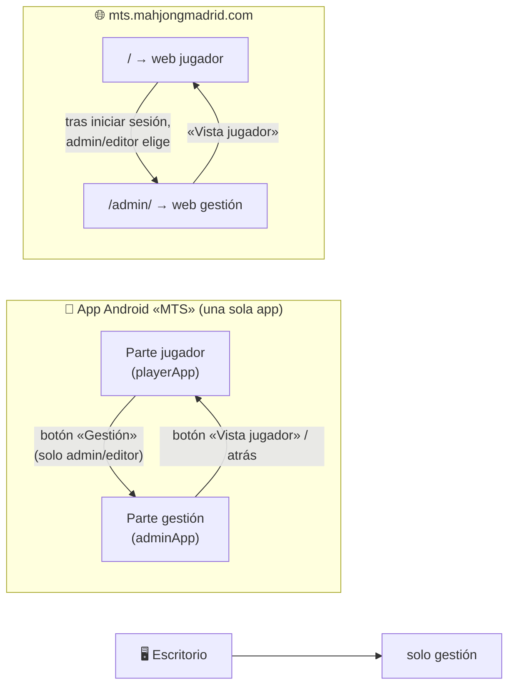
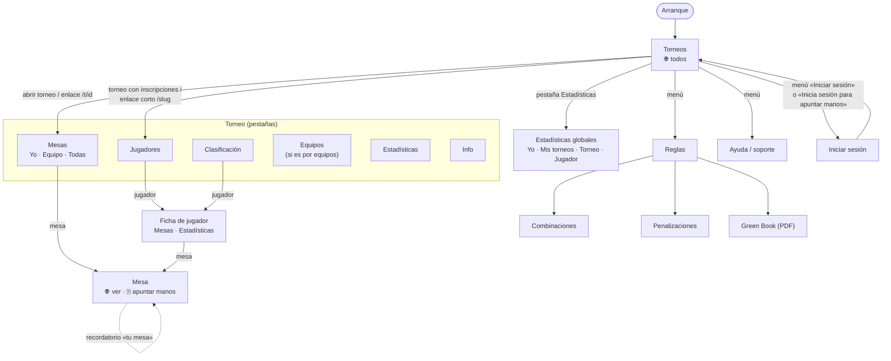

# Mapa de pantallas (wireframe)

Cómo se navega por las apps y qué ve cada rol. Las capturas son las de los tests de capturas (`*/screenshots/*/phone-light.png`, datos de ejemplo), así que se actualizan solas cuando se graban de nuevo. Hay versiones de escritorio, tablet y modo oscuro en las mismas carpetas.

## Cómo encajan las apps

## App de jugador

Empieza siempre en la lista de torneos. No hace falta cuenta para ver nada; la cuenta solo sirve para marcar «yo» y para apuntar manos en la propia mesa.

| Pantalla | Quién | Qué hace | Captura |
|---|---|---|---|
| **Torneos (sin cuenta)** | Todos | Lista de torneos públicos con filtros (estado, país, año). Botón de iniciar sesión. |  |
| **Torneos (con cuenta)** | Jugador | Igual, más el filtro «Mis torneos». |  |
| **Torneo › Mesas** | Todos | Pestañas Yo / Equipo / Todas. Mesas por ronda con resultados en vivo. |  |
| **Torneo › Clasificación** | Todos | Jugadores, equipos, manos pollo y mejor mano. |  |
| **Torneo › Jugadores** | Todos | Buscador; abre la ficha del jugador. |  |
| **Torneo › Jugadores (inscripciones)** | Todos ver · cualquiera se inscribe | Antes del sorteo solo hay Jugadores e Info. Plazas, lista de espera, Inscribirme, Mi inscripción (comida, equipo, baja) y «No tengo número EMA». Enlace corto `/<slug>`, p. ej. `/6thmmc` (docs/registrations.md). |  |
| **Torneo › Equipos** | Todos | Solo en torneos por equipos. |  |
| **Torneo › Estadísticas** | Todos | Totales y reparto de manos, por ronda. |  |
| **Torneo › Info** | Todos | Progreso, horario de rondas, sede, agenda y contacto. |  |
| **Ficha de jugador › Mesas** | Todos | Sus mesas en el torneo. |  |
| **Ficha de jugador › Estadísticas** | Todos | Puesto, habilidades y totales. |  |
| **Mesa (en juego)** | Todos ver · Jugador de la mesa apunta | Asientos, puntos y manos. El jugador de la mesa apunta manos, asientos y penalizaciones cuando la ronda está abierta. |  |
| **Mesa (terminada)** | Todos | Resultado final y detalle de manos. |  |
| **Estadísticas globales** | Todos | Pestañas Yo / Mis torneos / Torneo / Jugador. |  |
| **Combinaciones** | Todos | Las 81 combinaciones MCR con ejemplos de fichas. |  |
| **Penalizaciones** | Todos | Tabla de penalizaciones. |  |
| **Iniciar sesión** | Staff (super admin, admin de país, editor) | Web: si la cuenta es de staff elige «Vista jugador» o «Gestión». |  |
| **Torneos** | Super admin: todos · Admin de país: los de sus países · Editor: asignados | Crear (super admin y admin de país en sus países), editar, abrir. Barra superior: cuentas, registro EMA, reloj; menú DEV (super admin). |  |
| **Torneo (editor de rondas)** | Staff del torneo | Ronda › mesa: jugadores, asientos, puntos y las 16 manos. Menú: reloj, clasificación, estadísticas, exportar, control de ronda (también editores), actividad (admins). |  |
| **Inscripciones** | Staff del torneo | Antes del sorteo: enlace público, plazas, lista de espera, pagado, comida, importar el Google Form, ajustes y Hacer el sorteo. |  |
| **Mesas** | Staff del torneo | Todas las mesas con su estado y filtros. |  |
| **Jugadores del torneo** | Staff del torneo | Huecos, EMA ids, invitaciones, importación, sustituciones, tira de mesas por ronda. |  |
| **Número de jugadores** | Quien configura el torneo | Antes de la primera mano: marcar quién sale o añadir mesas, revisar y sorteo nuevo; quienes se quedan mantienen su número (docs/player-count-change.md). |  |
| **QR e IDs de mesa** | Admin o editor del torneo | Botón "QR" de la topbar del torneo: ventana aparte con el QR del torneo para proyectarlo (abre en el Player las mesas del jugador con su mesa en juego o la próxima). Menú More > "Tables IDs": diálogo con PDF de una tarjeta por mesa (número grande + QR), 1, 2, 4, 6 u 8 por A4, con vista previa (docs/table-qr.md). |  |
| **Equipos** | Staff del torneo | Nombre y miembros de cada equipo. |  |
| **Clasificación (pantalla grande)** | Staff del torneo | Para proyectar en la sala; pasa páginas sola. |  |
| **Reloj de ronda** | Staff del torneo | Inicia, pausa y ajusta el tiempo de la ronda; abre las manos a los jugadores. |  |
| **Estadísticas** | Staff | Del torneo, de una persona o de todos los torneos. |  |
| **Cuentas** | Staff: todos los jugadores y el staff de sus países · Super admin: todas | Crear (jugadores todos; editores y admins de país el admin de país), editar, quitar de mis países y solicitudes (admin de país), desactivar y borrar (super admin), email de contraseña. Botón **Permisos** de una cuenta de staff: rol a medida (también el Club Admin, en sus organizaciones) y casillas sueltas (super admin). |  |
| **Roles** | Super admin | Roles estándar (solo lectura, se pueden duplicar) y roles a medida que parten de Editor o Club Admin: nombre, casillas de permisos, cuántas cuentas lo usan. Se abre desde Cuentas. |  |
| **Registro EMA** | Super admin edita · Admin de país crea · Editor consulta | Jugadores EMA, fotos, ocultar del público, borrar jugadores EMA. |  |
| **Actividad** | Super admin (toda la app) · Admin de país (sus torneos) | Quién cambió qué y cuándo, con filtros. |  |
| **Errores de las apps** | Super admin | Errores agrupados de todas las apps. |  |
| **Design system** | Super admin | Catálogo de colores y componentes (menú DEV). |  |

Los diálogos (crear/editar torneo, invitar, importar jugadores, control de ronda, perfil…) tienen sus capturas en `adminApp/screenshots/dialogs/` y `playerApp/screenshots/dialogs/`.

## Qué rol ve qué (resumen)

| | Sin cuenta | Jugador | Editor | Admin de país | Super admin |
|---|:-:|:-:|:-:|:-:|:-:|
| Ver torneos públicos, mesas, clasificaciones, estadísticas | ✅ | ✅ | ✅ | ✅ | ✅ |
| Marcar «yo», «mis torneos» | | ✅ | ✅* | ✅* | ✅* |
| Apuntar manos/asientos en su mesa (ronda abierta) | | ✅ | ✅* | ✅* | ✅* |
| Gestionar torneos (jugadores, mesas, manos, reloj, control de ronda, exportar) | | | Asignados | Sus países | Todos |
| Crear/borrar/configurar torneos, vaciar mesa, actividad del torneo | | | | Sus países | Todos |
| Cambiar el país de un torneo, borrar uno pasado con datos | | | | | ✅ |
| Cuentas: crear jugadores | | | ✅ | ✅ | ✅ |
| Cuentas: editores y admins de país | | | | Sus países | ✅ |
| Desactivar/borrar cuentas, email o EMA id de una cuenta, solicitudes | | | | | ✅ |
| Registro EMA: crear / editar y borrar | | | | Crear | ✅ |
| Menú DEV: actividad de la app, errores, design system | | | | | ✅ |

\* si la cuenta también tiene EMA id. La matriz detallada está en [user-roles-matrix.md](../user-roles-matrix.md).
