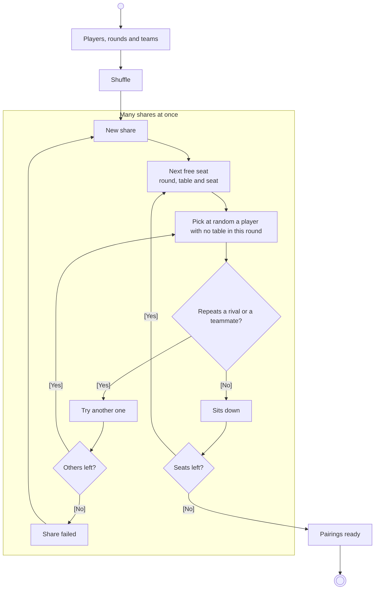
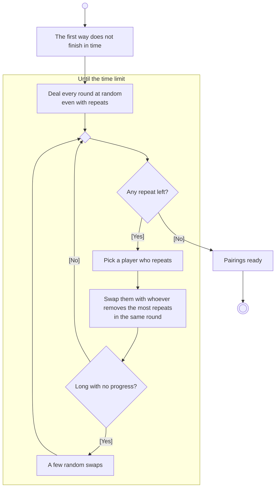
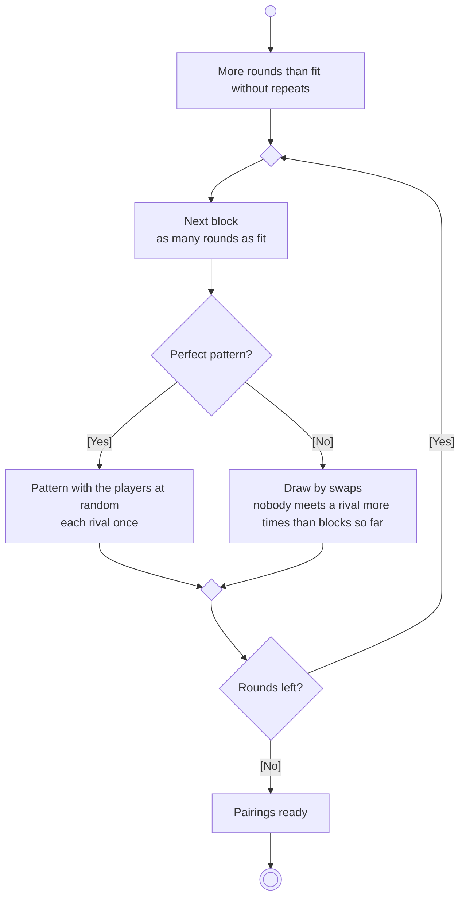

# The draw of the pairings

The app draws the tables of every round in one go, before the first hand: when a tournament is created, when its
registrations close (**Make the draw**), and when its number of players changes (docs/player-count-change.md). The
server checks the draw again and saves it.

Every draw keeps the same rules, whatever way finds it:

- Each player sits once in each round, at a table of 4.
- Nobody plays against the same person twice in the whole tournament (counting the tables already played, when there
  are some), unless there are more rounds than fit without repeats: then nobody meets anyone more times than the
  blocks begun (below).
- In a team tournament, two players of one team never share a table.
- The order of the tables and of the seats is random too.

There are two ways to draw. The app always starts with the first one, exactly as it always was. Only when the first
does not finish in its time does the second one run. With more rounds than fit without repeats, the draw goes in
blocks (below). The button **How does the draw work?** shows both, one after the
other, with a diagram each (`DrawExplanationDialog` in the `ui` module, shared by the admin app and the Player app).

## First way: seat by seat

`GenerateTournamentScheduleBruteForceParallelUseCase`. Diagram in the app: `DrawFlowDiagram`.

- It fills the tables seat by seat, round after round, with a random player who has no table yet in that round.
- If that player has already played against someone at the table, or is on the same team, it tries another one.
- If at some point nobody fits, the share fails and a new one starts from the beginning.
- Many shares run at once (one for each processor, more with heavy computing), and the first one that works wins.

It is fast for most tournaments. It gets slow, or never ends, with many rounds for few players, or with teams: the
denser the tournament, the more shares fail near the end. Measured on 22-nov (8 threads, 40 s): 28 x 7, 40 x 7 and
120 x 9 without teams, and 32 x 5, 40 x 7 with teams, were not found.

## Second way: by swaps

`GenerateScheduleBySwapsUseCase`. Diagram in the app: `DrawSwapFlowDiagram`. It only runs when the first way did not
finish in time.

- It deals every round at random at once, even with repeats.
- It counts the repeats: two players who meet more than once, two of one team at one table, or two who met at a table
  already played.
- It takes the players who sit with a repeat (up to 64, chosen at random when there are more) and, for each, tries
  every swap with a player of another table of the same round. It makes the swap that removes the most repeats; among
  equal ones it chooses at random.
- A swap just made is not undone for 8 to 15 steps (a "tabu" list), so it does not go round in circles. A swap that
  leaves no repeat at all is always allowed.
- After a long time with no progress, a few random swaps shake the draw. After 2 million swaps a search deals again.
- Several searches run at once, with different random numbers, and the first one with no repeat wins.
- With no repeat left, the order of the tables and of the seats is shuffled.

It also draws with tables already played and with slots that are not 1..N, which the change of the number of players
in a tournament in play needs.

## How long each way waits

`DrawTournamentScheduleUseCase` runs them one after the other. The time grows with the tables and rounds, because a big
tournament needs more time even when it is easy:

| Way | Time |
| --- | --- |
| First | 15 s + 0.1 s for each table of each round, at most 1 min |
| Second | 30 s + 0.5 s for each table of each round, at most 5 min |

If neither finds a draw, the app says that it could not draw (`error_schedule_generation`) and nothing is created or
changed. The progress dialogs say when the second way is running.

Measured on 22-nov (JVM, 4 workers, 3 draws each, in milliseconds; X = not found in 60 s). The first way did not find
28 x 7, 40 x 7 or 120 x 9, nor 32 x 5 or 40 x 7 with teams, in 40 s:

| Players x rounds | Second way | With teams |
| --- | --- | --- |
| 16 x 4 | 414, 14, 15 | 6, 9, 5 |
| 16 x 5 | 19, 60, 9 | impossible (12 rivals, 15 needed) |
| 20 x 5 | 125, 6, 17 | X X X |
| 24 x 6 | 4 674, 488, 3 623 | X X X |
| 28 x 7 | 13 269, 4 289, 22 745 | X X X |
| 32 x 5 | 9, 8, 16 | 13, 13, 13 |
| 32 x 7 | 28, 23, 22 | X, X, 20 800 |
| 32 x 8 | 21 790, X, 30 736 | X X X |
| 40 x 7 | 22, 25, 22 | 37, 34, 30 |
| 40 x 9 | 59, 47, 50 | X, 8 785, X |
| 64 x 10 | 92, 88, 83 | 106, 109, 104 |
| 100 x 7 | 68, 63, 76 | 85, 93, 90 |
| 240 x 11 | 549, 550, 432 | 588, 599, 698 |
| 400 x 15 | 1 927, 1 836, 1 890 | 2 244, 2 174, 2 373 |

Every draw found passed the checks of `DrawInvariants`. The cases still not found are next to the mathematical limit
(each player meets 3 rivals a round, so N players without teams can play (N - 1) / 3 rounds at most, and with teams
(N - 4) / 3).

## More rounds than fit without repeats

Asked by Ernesto on 22-nov and 23-nov. Each round a player meets 3 new rivals, so the new rivals run out:

| | Rounds without repeats |
| --- | --- |
| Ceiling (`RepeatFreeRounds.ceiling`) | (N - 1) / 3, with teams (N - 4) / 3 |
| Known maximum (`RepeatFreeRounds.max`) | the ceiling, except where it is known to be lower (20 players: 5, not 6) |
| Sure (`RepeatFreeRounds.sure`) | what the draw finds every time in seconds (below) |

The exact maximum is the "social golfer problem", open for many sizes. Teams and individual are one problem: the teams
are a round where everyone sits with their team, so a team tournament fits exactly one round less.

### The perfect pattern

When N = 16, 28, 40, 52, 64… (N - 4 a multiple of 12), there is a pattern of (N - 1) / 3 rounds where every pair meets
exactly once (a resolvable design). `PerfectPattern` keeps it for 16, 28, 40, 64 and 256:

- 16, 64 and 256: by formula, the lines of the 4 × 4 grid (and its 3D and 4D versions) over the field of 4 numbers.
  Each round is a direction.
- 28 and 40: found once by an exact search (`scripts/draw/resolvable_designs.py`, under a second) on the 28 points of
  the Hermitian curve over the field of 9 numbers and on the 40 points of the projective space PG(3, 3), and kept.

With teams, one round of the pattern is the teams and the others are the draw: (N - 4) / 3 rounds.

The pattern is a fixed shape; the chance is in who takes each place: the players are placed at random, the rounds,
tables and seats are shuffled, and each block places them again. For these sizes the pattern also takes the place of
the second way when the first is not in time, because it is instant (28 x 7 with teams, for example, was not found by
either way before).

### Blocks

`DrawRoundsInBlocksUseCase`. Diagram in the app: `DrawBlocksFlowDiagram`.

- The rounds go in blocks of `sure` rounds. In the first block nobody meets the same rival twice; in the second, nobody
  meets them a third time, and so on (the second way with `meetLimit` = the block). So after k blocks nobody has met
  anyone more than k times. The last block, even when shorter, keeps the rule.
- With a perfect pattern every complete block is the pattern, so after k blocks every pair has met exactly k times.
- With tables already played (a tournament in play), every block is drawn by swaps, counting those tables.
  Each block by swaps has 5 s of real time and tries again with another seed. The rounds left of a block that the
  played rounds already started may have no way to finish without one more meeting: then the last try allows it, from
  that block on (`BlocksResult.extraMeetings`), so the rounds left always get a draw.

`DrawTournamentScheduleUseCase` uses the blocks:

- at once, with more rounds than the known maximum;
- after both ways, with more rounds than `sure` but not more than the maximum, when neither found a draw.

Create tournament says it under the players and rounds (`RepeatRoundsNotice`), with the rounds that fit and the most
times two players will meet.

### What the draw finds for sure

Measured on 23-nov (JVM, 4 threads; the most rounds found twice in under 20 s each). The draw by swaps either finds
them in milliseconds or not in 20 s; 24 x 6 took 1 and 12 s, so 5 is kept as sure.

| Players | Ceiling | Sure | Ceiling, teams | Sure, teams |
| --- | --- | --- | --- | --- |
| 16 | 5 | 5 (pattern) | 4 | 4 (pattern) |
| 20 | 6 (max 5) | 5 | 5 (max 4) | 4 |
| 24 | 7 | 5 | 6 | 4 |
| 28 | 9 | 9 (pattern) | 8 | 8 (pattern) |
| 32 | 10 | 7 | 9 | 6 |
| 36 | 11 | 8 | 10 | 7 |
| 40 | 13 | 13 (pattern) | 12 | 12 (pattern) |
| 44 | 14 | 10 | 13 | 9 |
| 48 | 15 | 11 | 14 | 10 |
| others | (N - 1) / 3 | 70 % of the ceiling | (N - 4) / 3 | 70 % of the ceiling |

## Tests

- `GenerateTournamentScheduleInvariantsTest`: the first way, as it is, at the sizes it finds in seconds. Written before
  the second way, so it can never change the first one without a red test.
- `GenerateScheduleBySwapsTest`: the second way at the sizes the first does not solve, with teams, with tables already
  played, with slots that left or came, the maximum of 16 players (5 rounds), random draws, wrong inputs, the progress.
- `DrawTournamentScheduleUseCaseTest`: the first way when it is in time, the second one when it is not, no draw when
  neither, and the time limits.
- `DrawInvariants` (commonTest): the rules above as a list of problems, shared by all of them.
- `RepeatFreeRoundsTest`, `PerfectPatternTest` (commonTest): the ceilings, the sure rounds, and every pattern with
  every pair exactly once (and with teams, any round of it as the teams).
- `DrawRoundsInBlocksTest`: blocks after blocks, never more meetings than blocks begun, with and without teams, with
  tables already played and slots that are not 1..N.
