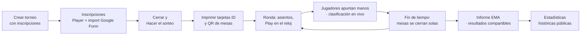

# Mahjong Tournament Suite: catálogo de funcionalidades

*Estado a 23 de noviembre de 2026 (web 1.0.36x, backend 1.0.4x). Sacado del código de `main` y de `docs/`.*

## Índice

1. [Qué es](#1-qué-es)
2. [Plataformas y cómo encajan las dos partes](#2-plataformas-y-cómo-encajan-las-dos-partes)
3. [Roles y permisos](#3-roles-y-permisos)
4. [Player: la app del jugador y del público](#4-player-la-app-del-jugador-y-del-público)
5. [Admin: la app de gestión](#5-admin-la-app-de-gestión)
6. [Compartido por las dos apps](#6-compartido-por-las-dos-apps)
7. [Un torneo de principio a fin](#7-un-torneo-de-principio-a-fin)
8. [Debajo del capó](#8-debajo-del-capó)
9. [Calidad, pruebas y ensayos](#9-calidad-pruebas-y-ensayos)

---

## 1. Qué es

Mahjong Tournament Suite (MTS) organiza torneos de Mahjong de reglas MCR (Mahjong Competition Rules, las de la EMA). Cubre todo el ciclo:

> **Inscripciones → sorteo → rondas con reloj → manos apuntadas en la mesa → clasificación en vivo → informe para la EMA → estadísticas históricas.**

Tiene dos partes:

| Parte | Para quién | Idea clave |
|---|---|---|
| **Player** | Jugadores y cualquier persona interesada | Todo es público. La cuenta solo sirve para saber «quién soy yo» y apuntar manos en tu mesa. |
| **Admin (Gestión)** | Organizadores, Club Admins y editores de mesa | Montar y llevar el torneo, desde las inscripciones hasta el informe final. |

Objetivo actual: estreno real en un torneo de unos 60 jugadores en febrero de 2027.

---

## 2. Plataformas y cómo encajan las dos partes

| Plataforma | Player | Admin |
|---|:-:|:-:|
| **Android** (app única «MTS») | ✅ arranca aquí | ✅ botón «Gestión» para staff |
| **Web** (Wasm) `mts.mahjongmadrid.com` | ✅ `/` | ✅ `/admin/` |
| **Escritorio** (JVM) | | ✅ |

- **Una sola app Android**: arranca en Player; si la cuenta es de staff, el botón «Gestión» lleva a la parte Admin y «Vista jugador» vuelve.
- **En web**, tras iniciar sesión, el staff elige «Vista jugador» o «Gestión».
- **Enlaces directos**: `/t/<id>` abre un torneo, `/<nombre-corto>` (p. ej. `/6thmmc`) abre sus inscripciones o el torneo tras el sorteo, `/<nombre-corto>/my-table` abre tu mesa. En Android son App Links: abren la app.
- **Atrás/adelante del navegador** funcionan como el atrás de la app, en las dos webs.

---

## 3. Roles y permisos

| Rol | Qué puede hacer |
|---|---|
| **Sin cuenta** | Ver todos los torneos públicos: mesas, clasificaciones, estadísticas, inscritos. Inscribirse confirmando el email. |
| **Jugador** | Lo anterior + «Mis torneos», marcar «yo», elegir asientos y apuntar manos y penalizaciones en su mesa con la ronda abierta. |
| **Editor** | Gestionar los torneos que tiene asignados: jugadores, mesas, manos, reloj, control de ronda, exportar. |
| **Club Admin** | Gestionar los torneos de sus organizaciones (clubs o federaciones) y las cuentas de su staff; crear jugadores EMA; editar la ficha de su club. |
| **Super Admin** | Todo: organizaciones, cuentas, registro EMA completo, roles a medida, actividad global, errores, menú DEV. |
| **Roles a medida** | El Super Admin crea roles que parten de Editor o Club Admin con las casillas de permisos que quiera, y puede añadir o quitar permisos sueltos a una persona. |

Organizaciones: cada torneo tiene un organizador principal y coorganizadores. El logo y el color del torneo salen del organizador principal.

---

## 4. Player: la app del jugador y del público

### 4.1 Lista de torneos

- **Pestañas En juego · Todos · Estadísticas.**
  - *En juego* aparece solo si hay torneos en curso, y se abre sola una vez si juegas uno ahora. Chip «Mis torneos» activado por defecto.
  - *Todos*: arriba los torneos en curso donde juegas; el resto por fecha, del más reciente o futuro al más antiguo.
- **Filtros combinables**: estado, país, año, «Mis torneos».
- **Sello de tinta** en tus torneos: *Jugando*, *Jugado*, *Inscrito* o *En espera*.
- **Puestos** en los torneos jugados: podio, equipo, mejor mano y mano pollo, con colores de medalla y tooltip.
- Botón de mapa junto a la ciudad para ir a la sede.

### 4.2 Inscripciones (antes del sorteo)

- Solo se ven las pestañas Jugadores e Info.
- **Plazas y lista de espera numerada**, visibles para todos: nombre, bandera, número EMA, estado y equipo.
- **Inscribirme**
  - Con cuenta EMA: plaza o lista de espera al momento.
  - Sin cuenta: te buscas en el registro EMA, pones tu email y confirmas con un enlace. Con ese enlace gestionas tu inscripción sin cuenta.
  - «No tengo número EMA»: envía un mensaje a la organización.
- **Mi inscripción**: restricciones alimentarias (privadas, con consentimiento explícito), equipo y baja (la organización recibe un email).
- **Equipos**: un capitán crea el equipo y añade hasta 3 inscritos por su número EMA, así una persona puede apuntar a todo el equipo. Recordatorio una semana antes del cierre a quien no tenga equipo completo.

### 4.3 Dentro de un torneo

Pestañas: **Mesas · Clasificación · Jugadores · Equipos** (solo por equipos) **· Estadísticas · Info**. La pestaña elegida se recuerda.

- **Mesas**: filtros Yo / Equipo / Todas, mesas por ronda con resultados en vivo.
- **Clasificación**: jugadores (con foto), equipos, manos pollo y mejor mano.
- **Jugadores**: buscador; abre la ficha del jugador.
- **Equipos**: ranking de equipos y detalle con miembros, mesas y estadísticas del equipo.
- **Estadísticas** del torneo, por ronda o del torneo entero.
- **Info**: progreso, horario de rondas, sede, agenda, contacto y organizadores con su logo.

### 4.4 Ficha de jugador

- Cabecera con foto, nombre, bandera y número EMA.
- **Mesas** del jugador en el torneo.
- **Resultados** («Mis resultados» si eres tú): tabla con Ronda, Mesa, Asiento (viento), Puntos, Puntuación, totales acumulados y Puesto tras cada ronda. **Botón Compartir** que la convierte en imagen PNG (menú de compartir en Android, compartir o descargar en web).
- **Estadísticas** del jugador.

### 4.5 La mesa

- **Asientos**: los jugadores de la mesa eligen Este, Sur y Oeste desde 10 minutos antes de la ronda hasta la primera mano; el que queda es Norte.
- **Apuntar manos**: ganador, quién descarta (o autopick), valor, y **penalizaciones**. Cada jugador aparece con bandera y «#N», su número en el torneo.
- **En vivo**: animación de mano nueva, corrección o borrado; totales que cuentan con «+N». Se ve igual en el móvil que guarda y en los demás.
- **Diferencias** entre jugadores (se puede ocultar por torneo).
- **Tiempo restante** de la ronda, con la hora del servidor (no importa si el reloj del móvil va mal).
- **Mesa terminada**: resultado final y detalle de todas las manos.
- Desde la barra superior: **Combinaciones**, **Penalizaciones** y **Green Book**.

### 4.6 Llegar a tu mesa

- **Aviso «Mesa N · Ronda R»** al abrir la app, desde 10 minutos antes de la ronda: «Ir a mi mesa» o «Más tarde». Dice cuánto falta o cuánto lleva la ronda, o «Esperando el gong inicial».
- **Botón flotante «Ir a mi mesa»** en todas las pantallas mientras tu ronda está en juego.
- **QR del torneo**: un único QR, en la sala o en las mesas, que abre «Mis mesas» y tu mesa en juego, o la próxima.

### 4.7 Estadísticas (todas públicas)

- **Una pantalla con fila de filtros**: jugador, rival, torneo, país de los torneos, país de los jugadores (o «Sin país») y años desde/hasta. Los filtros se mantienen al recargar.
- **Jugador**
  - Radar de **habilidades**: tasa de victoria, de autopick, de dar mano y valor medio de mano.
  - **Puestos**: anillo, puesto medio y gráfica de las últimas 10/20/50/todas las mesas, coloreada por torneo.
  - **Totales**, con anillo de manos ganadas, perdidas y empatadas.
  - **Récords**: mejor mesa, mejor mano, rachas, mesas sin dar mano, manos pollo, mayor penalización.
  - **Mejores rivales**: los 3 rivales más duros, con un tooltip que explica el criterio.
  - **Por ronda**: puesto, puntuación, habilidades y manos de cada ronda.
  - **Por torneo**: una tarjeta por torneo, con búsqueda y rango de fechas.
- **Torneo**: resumen, top de puntos, victoria, dar mano y autopick; manos por ronda; tiempo medio por mano; récords.
- **Equipo**: lo mismo que un jugador, con sumas del equipo y detalle por persona.

### 4.8 Reglas y ayuda

- **Combinaciones**: las 81 combinaciones MCR con dibujos de fichas y descripción, traducidas.
- **Penalizaciones**: tabla de referencia.
- **Green Book**: el reglamento en PDF en inglés y español (en Android se descarga y queda guardado) y enlace a la edición rusa.
- **Contacto** (formulario a la organización), **Privacidad** y **Reglas** en el menú ⋮.

### 4.9 Cuenta y preferencias

- Iniciar sesión es opcional; recuperar contraseña con confirmación del email.
- **Perfil**: foto, alias, tema (claro, oscuro o sistema), idioma, cerrar sesión, borrar cuenta y retirar el consentimiento de analíticas.
- **8 idiomas**: inglés, español, francés, italiano, alemán, sueco, neerlandés y ruso. Sigue el idioma del dispositivo hasta que eliges uno. Un aviso único indica que las traducciones son de IA, con un botón para escribir.
- **Refresco automático**: cada 15 s en un torneo en curso, cada 5 s para sus jugadores con la ronda en juego y cada 2 s en tu propia mesa.

---

## 5. Admin: la app de gestión

### 5.1 Torneos y organizaciones

- **Lista de torneos** según tu rol: todos, los de tus organizaciones o los asignados.
- **Crear torneo**
  - Individual o por equipos: jugadores, rondas, fechas, horario, sede (con Google Places), nombre corto, contacto, organizadores.
  - O **«Abrir inscripciones»**: el torneo nace sin jugadores y se sortea al cerrar.
- **Configuración**: torneo público o no, diferencias en las mesas, duración de la partida, horario y agenda.
- **Organizaciones** (clubs y federaciones): cuadrícula de tarjetas con buscador y filtro por país, logo, color y local opcional.

### 5.2 Sorteo de enfrentamientos

- Genera todas las rondas de una vez: nadie repite rival en todo el torneo y, por equipos, dos compañeros nunca comparten mesa. El orden de mesas y asientos también es al azar.
- **Dos métodos**: asiento a asiento y, si el primero no termina a tiempo, un segundo método por intercambios. Resuelve casos difíciles como 28 o 40 jugadores a 7 rondas, o equipos densos.
- **«¿Cómo funciona el sorteo?»**: diálogo con diagrama de flujo y textos sencillos (cómo funciona, qué garantiza y por qué es 100 % al azar). También está en el Player.

### 5.3 Inscripciones

- **Ajustes en la propia pantalla**: estado (abrir o cerrar), plazas, último día y enlace público con botón Copiar.
- **Lista** con buscador y chips (Todos, Con plaza, Lista de espera, Email sin confirmar) y cuántos han pagado.
- **Por persona**: cambiar email, equipo, comida o pagado; dar plaza; pasar a la lista de espera; quitar (con o sin email).
- **Importar** el Google Form o un fichero exportado (CSV o Excel, hasta 500 filas), con vista previa de errores por fila.
- **Exportar CSV**, que se puede volver a importar.
- **Correos automáticos**: confirmación al inscrito, aviso de bajas e informe semanal a la organización (domingo noche). Cierre automático el día después del último día.
- **Hacer el sorteo**: comprueba que los jugadores con plaza son múltiplo de 4, al menos 16, y que los equipos están completos.

### 5.4 Jugadores, equipos y cuentas

- **Jugadores del torneo**: huecos con número fijo «#N», número EMA, importación, sustituciones y una tira con las mesas de cada ronda bajo cada jugador.
- **Invitaciones** por email (en bloque) y recordatorios.
- **Cambiar el número de jugadores** antes de la primera mano: marcas quién sale o añades mesas, revisas y se sortea de nuevo. Quien se queda mantiene su número y su equipo, y todos los afectados reciben un email.
- **Equipos**: nombre y miembros.
- **Registro EMA**: jugadores EMA con foto (pública), ocultar del público, crear, editar y borrar, y todos los países más «Sin país».
- **Cuentas**: crear jugadores y staff, permisos, desactivar, borrar, email de contraseña. Cada pantalla borra solo lo suyo: borrar una cuenta no borra el jugador EMA, ni al revés.
- **Roles**: estándar (solo lectura, se pueden duplicar) y a medida, con casillas de permisos y cuántas cuentas usan cada uno.

### 5.5 Durante el torneo

- **Editor de rondas**: ronda › mesa, con jugadores, asientos, puntos y las 16 manos (ganador, descarte, valor, «Hecha»), penalizaciones y totales manuales.
- **Varios editores a la vez**: el servidor siempre gana. Si otro guardó antes, un diálogo lo dice y lista lo que habías escrito. Antes de guardar se avisa de las manos sin marcar como hechas.
- **Mesas**: todas, con su estado y filtros.
- **Reloj de ronda**
  - Iniciar, pausar, reanudar, fijar el tiempo y «empezó hace N min».
  - Al dar Play se abren las manos a los jugadores. Al acabar el tiempo, el servidor cierra las mesas solo.
  - Funciona sin red: reintenta con la hora del pulsado. Rojo en los últimos 15 min.
  - Hay también un reloj independiente, solo local, para cualquier uso.
- **Control de ronda** (plan B)
  - Abrir o cerrar a mano la entrada de manos y de asientos, por ronda o por mesa; marcar mesas como terminadas o en juego.
  - Aviso de **mesas abiertas en rondas terminadas**, con badge por ronda y diálogo Revisar para cerrarlas en bloque.
- **Clasificación a pantalla grande**: para proyectar en la sala; va pasando sola por jugadores, equipos, manos pollo y mejores manos.
- **QR del torneo**: QR en grande en una ventana aparte para proyectar, y PDF de tarjetas por mesa (número grande + QR) con 1, 2 o 4 por A4.
- **Estadísticas**: las mismas que el Player, con los mismos filtros.

### 5.6 Impresión y exportación

- **Tarjetas identificativas (PDF)** a doble cara con el nombre corto, el color y el logo del torneo.
  - Parte trasera opcional, o repetir la delantera.
  - **Hojas extra de sustitutos** (en blanco, para escribir a mano) y de **staff** (con nombres).
- **Informe EMA**: la tabla de resultados en el formato de la EMA, que se guarda como CSV para Excel.
- **CSV de inscripciones** (ver 5.3).

### 5.7 Supervisión

- **Actividad**: quién cambió qué y cuándo, con filtros y búsqueda, global o por torneo. Incluye las ejecuciones de scripts de mantenimiento.
- **Errores de las apps**: errores agrupados de todas las plataformas.
- **Menú DEV** (Super Admin): catálogo del design system y enlace a la documentación de arquitectura.

---

## 6. Compartido por las dos apps

- **Diseño**: design system propio (`:designsystem`), tema claro y oscuro, versión móvil y escritorio de cada pantalla, sombras y scrollbars en todas las listas, botones con texto salvo en pantallas estrechas.
- **Inicio de sesión** común, con Contacto, Privacidad y «¿Olvidaste la contraseña?».
- **Perfil** común (foto, tema, idioma).
- **Analíticas** (GA4) con consentimiento, y registro de errores propio.
- **Accesibilidad de teclado** en el escritorio: Tab, flechas, Enter y Enter del teclado numérico.

---

## 7. Un torneo de principio a fin

---

## 8. Debajo del capó

- **Cliente**: Kotlin Multiplatform + Compose Multiplatform (Android, Wasm, JVM). Módulos `domain`, `data`, `ui`, `designsystem`, `playerApp`, `adminApp`, `androidApp`. Koin, Ktor, kotlinx.serialization y Navigation Compose.
- **Backend**: una Cloud Function HTTP `api` (Node 22 + Express, TypeScript) en Madrid, más tareas en Bélgica (cierre de rondas con Cloud Tasks y job horario de inscripciones).
- **Datos**: Firestore y Storage con reglas que lo deniegan todo; solo el backend escribe. Firebase Auth con *custom claims*. App Check en modo monitor.
- **API pública** `/public/...` con caché CDN para el Player; API documentada con Swagger en `/api-docs/`.
- **Entornos**: producción y staging (`mts---staging.web.app`, APK «MTS Staging»).
- **Despliegue**: GitHub Actions (Firebase, web y Google Play), con versiones separadas de web, app y backend.

---

## 9. Calidad, pruebas y ensayos

- **Tests unitarios y multiplataforma** de dominio, datos y backend, más tests de integración con emuladores de Firebase.
- **Tests E2E** en emuladores Android: torneos completos (journey), en paralelo en 3 emuladores.
- **Capturas automáticas** (Roborazzi) de todas las pantallas y diálogos, en los 8 idiomas, con una galería web que guarda el historial de 30 versiones para comparar.
- **Cobertura de analíticas**: un test falla si una pantalla o acción no tiene su evento.
- **Game day**: bots que simulan torneos reales (pequeño, mediano y grande) contra staging, incluidos casos límite como sustituciones, caídas de red, empates, inscripciones por la UI y cambio de número de jugadores. Todos en verde.
