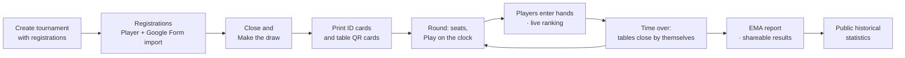

# Mahjong Tournament Suite: feature catalogue

*State on 23 November 2026, taken from the code on `main` and from `docs/`.*

## Contents

1. [What it is](#1-what-it-is)
2. [Platforms and how the two parts fit](#2-platforms-and-how-the-two-parts-fit)
3. [Roles and permissions](#3-roles-and-permissions)
4. [Player: the app for players and the public](#4-player-the-app-for-players-and-the-public)
5. [Admin: the management app](#5-admin-the-management-app)
6. [Shared by both apps](#6-shared-by-both-apps)
7. [A tournament from start to finish](#7-a-tournament-from-start-to-finish)
8. [Under the hood](#8-under-the-hood)
9. [Quality, tests and rehearsals](#9-quality-tests-and-rehearsals)

---

## 1. What it is

Mahjong Tournament Suite (MTS) runs Mahjong tournaments with MCR rules (Mahjong Competition Rules, the EMA rules). It covers the whole cycle:

> **Registrations → draw → rounds with a clock → hands entered at the table → live ranking → report for the EMA → historical statistics.**

It has two parts:

| Part | For whom | Key idea |
|---|---|---|
| **Player** | Players and anyone interested | Everything is public. An account only says «who I am» and lets you enter hands at your own table. |
| **Admin (Management)** | Organizers, Club Admins and table editors | Set up and run the tournament, from the registrations to the final report. |

---

## 2. Platforms and how the two parts fit

| Platform | Player | Admin |
|---|:-:|:-:|
| **Android** (one «MTS» app) | ✅ starts here | ✅ «Management» button for staff |
| **Web** (Wasm) `mts.mahjongmadrid.com` | ✅ `/` | ✅ `/admin/` |
| **Desktop** (JVM) | | ✅ |

- **One Android app**: it starts in Player. If the account is staff, the «Management» button opens the Admin part and «Player view» goes back.
- **On the web**, after signing in, staff choose «Player view» or «Management».
- **Direct links**: `/t/<id>` opens a tournament, `/<short-name>` (for example `/6thmmc`) opens its registrations, or the tournament after the draw, and `/<short-name>/my-table` opens your table. On Android the app takes every address of the site (App Links) and opens it where the web does; the pages that are not the app (privacy policy, Green Book, API docs) go on to the browser.
- **Browser back/forward** work like the app's back button on both web apps.

---

## 3. Roles and permissions

| Role | What it can do |
|---|---|
| **No account** | See every public tournament: tables, rankings, statistics, registered people. Register by confirming an email. |
| **Player** | The above, plus «My tournaments», marking «me», and setting seats and entering hands and penalties at their own table while the round is open. |
| **Editor** | Run the tournaments assigned to them: players, tables, hands, clock, round control, export. |
| **Club Admin** | Run the tournaments of their organizations (clubs or federations) and the accounts of their staff; create EMA players; edit their club's page. |
| **Super Admin** | Everything: organizations, accounts, the full EMA registry, custom roles, global activity, errors, DEV menu. |
| **Custom roles** | The Super Admin creates roles based on Editor or Club Admin with the permission boxes they choose, and can add or remove single permissions for one person. |

Organizations: each tournament has a main organizer and co-organizers. The tournament's logo and color come from the main organizer.

---

## 4. Player: the app for players and the public

### 4.1 Tournament list

- **Tabs In play · All · Statistics.**
  - *In play* shows only while tournaments are in progress, and opens by itself once if you are playing one now. The «My tournaments» chip is on by default.
  - *All*: first the tournaments in progress where you play; then the rest by date, from the newest or upcoming to the oldest.
- **Combinable filters**: status, country, year, «My tournaments».
- **Ink stamp** on your tournaments: *Playing*, *Played*, *Registered* or *Waiting list*.
- **Places** in played tournaments: podium, team, best hand and chicken hand, with medal colors and a tooltip.
- A map button beside the city opens the way to the venue.

### 4.2 Registrations (before the draw)

- Only the Players and Info tabs show.
- **Places and a numbered waiting list**, visible to everyone: name, flag, EMA number, status and team. A place that
  frees up goes to the first of the waiting list at once, with an email to that person and to the organization.
- **Register**
  - With an EMA account: a place or the waiting list at once.
  - Without an account: find yourself in the EMA registry, enter your email and confirm with a link. That link manages your registration without an account.
  - «I have no EMA number»: sends a message to the organization.
- **My registration**: food restrictions (private, with explicit consent), team and cancellation (the organization gets an email).
- **Teams**: a captain creates the team and adds up to 3 registered people by their EMA number, so one person can register the whole team. A reminder goes out one week before the close to anyone without a full team.

### 4.3 Inside a tournament

Tabs: **Tables · Ranking · Players · Teams** (team tournaments only) **· Statistics · Info**. The chosen tab is remembered.

- **Tables**: filters Me / Team / All, tables by round with live results.
- **Ranking**: players (with photo), teams, chicken hands and best hand. A round button next to the search shows the ranking of **now** or as it was **after a past round**, and **Share** opens a preview of the ranking on screen and shares it as a PNG image.
- **Players**: search; opens the player page.
- **Teams**: team ranking and a detail with members, tables and team statistics.
- **Statistics** of the tournament, per round or for the whole tournament.
- **Info**: progress, round times, venue, agenda, contact and organizers with their logo.

### 4.4 Player page

- Header with photo, name, flag and EMA number.
- **Tables** of the player in the tournament.
- **Results** («My results» when it is you): a table with Round, Table, Seat (wind), Table points, Score, running totals and Place after each round, with a small chart of the place after each round under it. A **Share** button turns it into a PNG image (share sheet on Android, share or download on the web).
- **Statistics** of the player.

### 4.5 The table

- **Seats**: the players of the table choose East, South and West from 10 minutes before the round until the first hand; the one left is North.
- **Enter hands**: winner, who discarded (or self-draw), value, and **penalties**. Each player shows with their flag and «#N», their number in the tournament.
- **Live**: animation of a new, corrected or deleted hand; totals that count up with «+N». It looks the same on the phone that saves and on the others.
- **Differences** between players (can be hidden per tournament).
- **Time left** in the round, using the server's time (a wrong phone clock does not matter).
- **Completed table**: final result and every hand in detail.
- From the top bar: **Combinations**, **Penalties** and **Green Book**.

### 4.6 Getting to your table

- **«Table N · Round R» reminder** when you open the app, from 10 minutes before the round: «Go to my table» or «Later». It says how long until the start or since the gong, or «Waiting for the starting gong».
- **Floating «Go to my table» button** on every screen while your round is in play.
- **Tournament QR code**: one QR code, in the venue or on the tables, that opens «My tables» and your table in play, or the next one.

### 4.7 Statistics (all public)

- **One screen with a row of filters**: player, tables against a rival (only players that the player met), tournament, country of the tournaments, country of the players (or «No country») and years from/to. The filters survive a reload.
- **Player**
  - **Skills** radar: win rate, self-draw rate, deal-in rate and average hand value.
  - **Places**: ring, average place and a chart of the last 10/20/50/all tables, colored by tournament.
  - **Totals**, with a ring of hands won, lost and drawn.
  - **Records**: best table, best hand, streaks, tables without dealing in, chicken hands, highest penalty.
  - **Best rivals**: the 3 toughest rivals, with a tooltip that explains the criteria.
  - **By round**: place, score, skills and hands of each round.
  - **By tournament**: one card per tournament, with search and a date range.
  - With one tournament chosen, the **Standing** card shows a small chart of the place after each round.
- **Tournament**: summary; tops for points, win rate, deal-in rate and self-draws; hands per round; average time per hand; records.
- **Team**: the same as a player, with team sums and a breakdown per person.

### 4.8 Rules and help

- **Combinations**: the 81 MCR combinations with tile pictures and descriptions, translated.
- **Penalties**: reference table.
- **Green Book**: the rulebook as a PDF in English and Spanish (on Android it downloads and stays saved), and a link to the Russian edition.
- **Contact** (a form to the organization), **Privacy** and **Rules** in the ⋮ menu.

### 4.9 Account and preferences

- Signing in is optional; password recovery with a confirmation of the email.
- **Profile**: photo, alias, theme (light, dark or system), language, sign out, delete the account and withdraw the analytics consent.
- **8 languages**: English, Spanish, French, Italian, German, Swedish, Dutch and Russian. The app follows the device language until you choose one. A one-time notice says the translations are made by AI, with a button to write in.
- **Automatic refresh**: every 15 s in a tournament in progress, every 5 s for its players while their round is in play, and every 2 s at your own table.

---

## 5. Admin: the management app

### 5.1 Tournaments and organizations

- **Tournament list** by role: all, those of your organizations, or those assigned to you.
- **Create a tournament**
  - Individual or teams: players, rounds, dates, schedule, venue (with Google Places), short name, contact, organizers.
  - Or **«Open registrations»**: the tournament starts with no players and the draw happens at the close.
- **Settings**: public or not, differences at the tables, match length, schedule and agenda.
- **Organizations** (clubs and federations): a grid of cards with search and a country filter, logo, color and an optional club venue.

### 5.2 Draw of the pairings

- It draws every round at once: nobody meets the same rival twice in the whole tournament and, in team tournaments, two teammates never share a table. The order of the tables and seats is random too.
- **Two methods**: seat by seat and, when the first one does not finish in time, a second method by swaps. It solves hard cases such as 28 or 40 players over 7 rounds, or dense teams.
- **More rounds than fit without repeats** go in blocks: each block has no repeated rival, with a perfect pattern for 16, 28, 40, 64 and 256 players. A block by swaps has a time limit, tries again and then allows one more meeting, so a started tournament always gets its rounds left.
- **«How does the draw work?»**: a dialog with a flowchart and plain words (how it works, what it guarantees, and why it is 100 % random). It is in the Player too.

### 5.3 Registrations

- **Settings on the screen itself**: status (open or close), places, last day and public link with a Copy button.
- **List** with search, chips (All, With a place, Waiting list, Email not confirmed, and With problems after an import) and how many have paid.
- **Per person**: change email, team, food or paid; give a place; move to the waiting list; remove (with or without an email).
- **Import** the Google Form or an exported file (CSV or Excel, up to 500 rows): the button opens the file picker, and a review shows the problems of each row and warns how many registrations go away, because the file **replaces** the list (no emails are sent).
  - Rows with problems (invalid, repeated or unknown EMA number, invalid email) are imported too and marked in the list. **Edit** picks the right person from the EMA registry, and a new email clears the email problem.
- **Export CSV**, which can be imported again.
- **Automatic emails**: confirmation to the person, cancellations and a weekly report to the organization (Sunday evening). The registrations close by themselves the day after the last day.
- **Make the draw**: checks that the people with a place are a multiple of 4, at least 16, that none has an EMA number problem of the import, and that the teams are complete.

### 5.4 Players, teams and accounts

- **Tournament players**: slots with a fixed number «#N», EMA number, import, substitutions, and each player's tables per round, folded until a «Tables» button opens them.
  - The top bar has **Teams**, **ID cards**, **ID list** and **Invitations** at the left, and Import and Export at the right.
- **Invitations** by email (in bulk) and reminders.
- **Change the number of players** before the first hand: mark the people who leave or add tables, review, and a new draw. Those who stay keep their number and team, and everyone affected gets an email.
  - In a team tournament a **Teams** step completes the teams that lose people: «Complete the teams» with the proposal, or drag people between teams by hand. Every team must end with 4, and the server checks it again.
- **Teams** (opens from Players): name and members.
- **EMA registry**: EMA players with photo (public), hide from the public, create, edit and delete, and every country plus «No country».
- **Accounts**: create players and staff, permissions, deactivate, delete, password email. Each screen deletes only its own: deleting an account does not delete the EMA player, nor the other way round.
- **Roles**: standard (read only, can be duplicated) and custom, with permission boxes and how many accounts use each one.

### 5.5 During the tournament

- **Round editor**: round › table, with players, seats, points and the 16 hands (winner, discard, value, «Done»), penalties and manual totals.
- **Top bar**: Timer, Ranking, QR and Round control during the rounds; Players, Tables IDs, Stats, EMA report and Activity in a **More** menu.
- **Several editors at once**: the server always wins. If someone else saved first, a dialog says so and lists what you had typed. Before saving, it warns about hands not marked as done.
- **Tables**: all of them, with their status and filters.
- **Round clock**
  - Start, pause, resume, set the time and «started N min ago».
  - Play opens hand entry to the players. When the time ends, the server closes the tables by itself.
  - It works without network: it retries with the time of the press. It turns red in the last 15 min.
  - There is also an independent, local-only clock for any use.
- **Round control** (plan B)
  - Open or close hand entry and seats by hand, per round or per table; mark tables as completed or in play.
  - A warning for **open tables in finished rounds**, with a badge per round and a Review dialog to close them in bulk.
- **Big-screen ranking**: to project in the venue; it pages by itself through players, teams, chicken hands and best hands.
- **Tournament QR code**: a big QR code in a separate window to project ("QR" button), with the logo of the main organizer (or its initial) and «Or just open the app:» with the main site. The «Tables IDs» dialog previews and downloads a PDF of cards per table (big number + QR code, tournament name in grey) with 1, 2, 4, 6 or 8 per A4 sheet.
- **Statistics**: the same as the Player, with the same filters.

### 5.6 Printing and export

- **ID cards (PDF)**, two-sided, with the tournament's short name, color and logo.
  - Optional back side, or repeat the front.
  - **Extra sheets of substitutes** (blank, to write by hand) and of **staff** (with names).
- **EMA report**: the results table in the EMA's format, saved as a CSV for Excel.
- **Registrations CSV** (see 5.3).

### 5.7 Oversight

- **Activity**: who changed what and when, with filters and search, global or per tournament. It includes the runs of maintenance scripts.
- **App errors**: errors grouped from every platform.
- **DEV menu** (Super Admin): design system catalogue and a link to the architecture docs.

---

## 6. Shared by both apps

- **Design**: own design system (`:designsystem`), light and dark theme, phone and desktop layout of each screen, fading edges and scrollbars on every list, buttons with text except on narrow screens.
- **Checkboxes, switches and radio buttons** also change when you tap their text.
- **Sign-in** shared, with Contact, Privacy and «Forgot password?».
- **Profile** shared (photo, theme, language).
- **Analytics** (GA4) with consent, and an own error log.
- **Keyboard support** on desktop: Tab, arrows, Enter and the numeric keypad Enter.

---

## 7. A tournament from start to finish

---

## 8. Under the hood

- **Client**: Kotlin Multiplatform + Compose Multiplatform (Android, Wasm, JVM). Modules `domain`, `data`, `ui`, `designsystem`, `playerApp`, `adminApp`, `androidApp`. Koin, Ktor, kotlinx.serialization and Navigation Compose.
- **Backend**: one HTTP Cloud Function `api` (Node 22 + Express, TypeScript) in Madrid, plus jobs in Belgium (round close with Cloud Tasks and the hourly registrations job).
- **Data**: Firestore and Storage with rules that deny everything; only the backend writes. Firebase Auth with custom claims. App Check in monitor mode.
- **Public API** `/public/...` with CDN caching for the Player; API documented with Swagger at `/api-docs/`.
- **Environments**: production and staging (`mts---staging.web.app`, «MTS Staging» APK).
- **Deploys**: GitHub Actions (Firebase, web and Google Play), with separate versions for web, app and backend.

---

## 9. Quality, tests and rehearsals

- **Unit and multiplatform tests** of domain, data and backend, plus integration tests on the Firebase emulators.
- **E2E tests** on Android emulators: whole tournaments (journey tests), in parallel on 3 emulators.
- **Automatic screenshots** (Roborazzi) of every screen and dialog, in all 8 languages, with a web gallery that keeps the history of 30 versions to compare.
- **Analytics coverage**: a test fails when a screen or action has no event.
- **Game day**: bots that simulate real tournaments (small, medium and large) against staging, including edge cases such as substitutions, network loss, ties, registrations through the UI and changing the number of players. All green.
